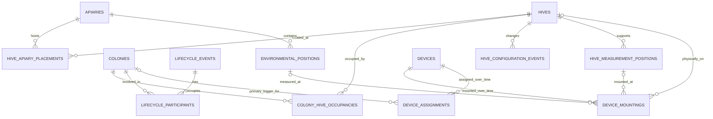

# Fachentwurf 0.1 – Beute, Bienenvolk und Bienenstand: Identitäten, Kardinalitäten, Historie

**Datum:** 12.10.2026  
**Status:** **Fachlicher Entwurf – noch kein genehmigtes SQL-/Tabellenschema (G0)**  
**Änderungsklasse:** D0 (Dokumentation), T0 = Abgleich mit bestätigten Betreiberentscheidungen und vorhandenen Architekturunterlagen. Keine Datenbank-, Migrations-, Feld- oder Funktionstests.  
**Verbindliche Betreiberentscheidungen vom 12.10.2026:** **[BESTÄTIGT]** Die **physische Beute** wird als **eigenständige, dauerhaft identifizierbare Entität mit Historie** geführt. Sie ist ausdrücklich nicht identisch mit Bienenvolk, Bienenstand, Sensor oder Messgerät. **[BESTÄTIGT]** Eine Beute darf **gleichzeitig höchstens ein Bienenvolk beherbergen**, kann aber auch unbewohnt sein. Nacheinander sind verschiedene Völker möglich. **[OFFEN]** Ob ein Volk zeitgleich mehrere Beuten nutzen darf, wurde damit nicht ausdrücklich entschieden.  
**Lesehilfe:** **[BESTÄTIGT]** = ausdrückliche Anforderung; **[VORSCHLAG]** = noch nicht beschlossene genaue Modellierung; **[OFFEN]** = erfordert weitere Entscheidung; **[BEISPIEL]** = synthetischer Testfall, keine reale Betriebsaufnahme.

**Übergeordnete Dokumente:** [Anforderungen](anforderungen-datenplattform.md), [allgemeine Messgrößen](messgroessen-am-bienenvolk.md), [Messreihe, Messkontext und Datenqualität](messreihe-messkontext-zeitqualitaet-v01.md), [ER-Gesamtentwurf](er-modell-datenplattform-v01.md).

## 1. Bindende Identitätsregeln

| Objekt | Verbindlich oder Vorschlag | Bedeutung / unveränderliche Identität |
|---|---|---|
| **Bienenvolk** (`colony`) | **BESTÄTIGT** | eigenständiger biologischer/betrieblicher Lebenslauf. Ableger = **neues Volk mit neuer ID**; Muttervolk bleibt eigene ID, Abstammungsereignis muss verknüpft werden |
| **Beute** (`hive`) | **BESTÄTIGT** | eigenständiger **physischer** Beutenkörper / identifizierbare Stockeinheit unabhängig vom gerade darin befindlichen Volk und Sensor |
| **Bienenstand** (`apiary`) | **BESTÄTIGT** | eigenständiger Standort, an dem sich Beuten über bestimmte Zeitintervalle befinden |
| **Messgerät** (`device`) | **BESTÄTIGT** | technische Identität; beelogger, BEEP Base und Umweltgeräte sind weder Beute noch Volk |
| **Messposition** (`measurement_position`) | **BESTÄTIGTE TRENNUNG**, genaue Struktur **VORSCHLAG** | Brutbereich, Beutendeckel, Waagenposition, Standortwetter, Bodentiefe usw. sind vom Gerät/Volk unabhängig zu beschreiben |
| **Beutenkomponente** (`hive_component`) | **VORSCHLAG, OFFEN** | optional separat identifizierbare Zarge, Boden, Deckel, Rähmchen, Aufsatz; nicht automatisch für jede Schraube eigene ID |
| **Königin** | **VORSCHLAG, OFFEN** | eigene biologische Abstammung und Wechselhistorie später von Volkshistorie trennen |

**Regel:** Eine ID wird nie wiederverwendet. Eine alte Beute-ID, Volk-ID oder Geräte-ID wird nicht bei einem Umzug durch die neue Standort-/Gerätekennung ersetzt. Eine physische Beute darf auch **leer, stillgelegt oder ohne bekannte Volkzuordnung** sein. „Keine dokumentierte Belegung“ und „nachweislich leer“ sind **unterschiedliche Wissensstände**.

**Offene Identitätsdefinition:** Ob die „Beute“ der feste Beutenboden/Rumpf oder die als Einheit identifizierte, gegebenenfalls umgebaute Stockkonstruktion ist, muss vor der Implementierung präzisiert werden. Für diesen Entwurf bezeichnet `hive` die **dauerhaft verfolgte Stockeinheit**, während Zargen etc. als zeitlich veränderlicher Aufbau geführt werden können. Ein vollständiger Austausch der Beutenkonstruktion kann eine neue ID erfordern – Kriterien **offen**.

## 2. Fachliche Beziehungsgrafik (keine SQL-DDL)



**Interpretation:** Historische Relationen sind selbstständige Datensätze. Die Kardinalität über die **gesamte Lebensdauer** (`0..n`) bedeutet nicht, dass beliebige parallele aktuelle Belegungen zulässig sind. Zeitliche Eindeutigkeit wird über fachliche Constraints definiert.

**Keine Vermischung:** `DEVICE_MOUNTINGS` dokumentiert den tatsächlichen **physischen Geräteort** an einer Beute oder Umweltmessstelle. `DEVICE_ASSIGNMENTS` dokumentiert eine **logische Primärfunktion** (welches Stockmesssystem welchem Volk zugeteilt ist). Beide Beziehungen müssen anhand der **Gültigkeitsintervalle** konsistent aufgelöst werden; ein auf einer leeren Beute verbliebener Logger darf nicht automatisch dem zuvor dort befindlichen Volk zugeschrieben werden. Eine direkte fachliche Verknüpfung eines Geräts mit einem Volk ist möglich, aber kein Ersatz für die physische Messposition, wenn diese bekannt ist. Eine BEEP Base bleibt als primäres System **alternative** zu beelogger.

## 3. Tabellenkandidaten und Kardinalitäten

**Alle Tabellen- und Spaltennamen in diesem Abschnitt sind [VORSCHLAG].**

| Entität | Kernattribute | Historienregel |
|---|---|---|
| `colonies` | `colony_id`, öffentlicher Anzeigename?, Lebenszyklusstatus | permanente Identität; neue ID für Ableger |
| `hives` | `hive_id`, eindeutige interne Beutenkennzeichnung, Zustand | permanente physische Identität; Austausch einer Zarge allein kein automatischer ID-Wechsel |
| `apiaries` | `apiary_id`, interne Bezeichnung, Standortschutz | Standortidentität unabhängig von Geräten/Völkern |
| `colony_hive_occupancies` | `occupancy_id`, `colony_id`, `hive_id`, `valid_from`, `valid_to`, `certainty`, `source_event_id?` | Volk nutzt Beute **in bestimmtem Zeitraum** |
| `hive_apiary_placements` | `placement_id`, `hive_id`, `apiary_id`, `valid_from`, `valid_to`, `certainty` | Beute befindet sich zu bestimmtem Zeitpunkt an Stand |
| `hive_configuration_events` | `event_id`, `hive_id`, `happened_at`, `change_type`, Details/Quelle | Auf-/Absetzen von Zargen, Boden/Deckel-Austausch, Reparatur, Änderung der Waagenaufstellung |
| `lifecycle_events` | `event_id`, `type`, `happened_at`, externe BEEP-Referenz? | biologisches Volkereignis, nicht Messwert |
| `lifecycle_participants` | `event_id`, `colony_id`, `role`, `certainty` | Herkunfts- und Ergebnisvölker, z. B. Ableger/Vereinigung |
| `hive_measurement_positions` | `position_id`, `hive_id`, `zone`, genaue Lage?, Validität? | reproduzierbarer Messort innerhalb/an einer Beute |
| `environmental_positions` | `position_id`, `apiary_id`, `medium`, Höhe/Tiefe, Ortsinformation, gültige Zeit | wetter-/bodenbezogener Messpunkt, **kein Volk-Sensor** |
| `device_mountings` | `mounting_id`, `device_id`, physisches Ziel, `valid_from`, `valid_to` | zeitlich belegbarer Montageort, auch an **unbesetzter** Beute |
| `device_assignments` | `assignment_id`, `measurement_unit_id`, `colony_id`, Rolle, `valid_from`, `valid_to` | pro Volk höchstens **eine** primäre Stockmesseinheit je Zeitpunkt; beelogger **oder** BEEP Base **oder keine** |
| `colony_apiary_fallbacks` | `colony_id`, `apiary_id`, `valid_from`, `valid_to`, `evidence` | **nur** expliziter historischer Ersatznachweis, wenn keine gültige Beuten-/Standverknüpfung vorliegt; Konfliktregel zwingend |
| `external_references` | interne Objekt-ID, BEEP-/beelogger-Referenz, Quellprofil, Zeitgültigkeit | verhindert Kopplung der Identität an BEEP-/Loggerkennungen |

**Wichtige Modellentscheidung [VORSCHLAG]:** `hive_measurement_positions` und `environmental_positions` haben unterschiedliche fachliche Eltern-IDs. Das finale SQL-Schema muss Fremdschlüssel und exklusive Zielbeziehungen sauber absichern; `target_type + target_id` ohne referenzielle Integrität soll **nicht** unbesehen übernommen werden.

**Mehrfachlogger:** Das Modell kann optional mehrere logische Messeinheiten unter einer Geräte-ID führen. Im vorgesehenen Normalfall genügt eine Stockmesseinheit je beelogger/BEEP Base; Mehrfachgeräte sind **nicht** aktueller Ausbau.

## 4. Zeitregeln und fachliche Integrität

**[VORSCHLAG]** Jedes Zuordnungsintervall wird als `[valid_from, valid_to)` in **UTC** interpretiert; `valid_from` inklusive, `valid_to` exklusive, offenes Ende möglich. **Der Messzeitpunkt bzw. ein eindeutig definierter Messzeitraum**, nicht die Importzeit, entscheidet über die historische Verknüpfung.

### Invarianten im Normalfall

1. **Volk–Beute (teilweise BESTÄTIGT):** Eine **Beute beherbergt höchstens ein Volk gleichzeitig** (**0..1**, ausdrücklich bestätigt). Der Normalfall „ein Volk belegt gleichzeitig höchstens eine Beute“ bleibt **[VORSCHLAG / OFFEN]**, nicht aus der bestätigten Gegenrichtung ableiten. Baulich getrennte Abteile dürfen die bestätigte Regel **nicht stillschweigend umgehen**; ob solche Abteile als eigene identifizierbare Beuten modelliert werden, bleibt für den Sonderfall offen.
2. **Beute–Stand:** Eine Beute steht zum Zeitpunkt `t` an **höchstens einem** Bienenstand; Lücken/unbekannte Zeiten bleiben ausdrücklich möglich.
3. **Primäre Stockmessung:** Ein Volk besitzt zu `t` **höchstens eine** primäre Messeinheit, entweder beelogger **oder** BEEP Base, oder **keine**. Die digitale BEEP-Stockkarte ist **unabhängig** davon.
4. **Gerätezuordnung:** Derselbe physische Montagepunkt / dieselbe Messeinheit darf nicht ohne explizite Mehrfach-/Sonderkonfiguration als zwei gleichzeitige primäre Stockmesseinheiten gelten.
5. **Kein Identitätswechsel durch Technik:** Sensorwechsel, Loggerwechsel, Batterieservice oder Kalibrierung erzeugen **keine** neue Volk-ID oder Beute-ID.
6. **Historie bewahren:** Alte Zuordnungen werden bei einem Umzug geschlossen und neue eröffnet. Nachträgliche Korrekturen sollen über Provenienz-/Änderungshistorie nachvollziehbar sein; keine unsichtbare Überschreibung.
7. **Messposition bleibt physisch korrekt:** Temperatur am Deckel, Schall im Brutbereich, Gewicht an der Waage etc. sollen einer **physischen Beute/Position** oder einem **Umweltmesspunkt** zugeordnet werden. Die Volkzuordnung zum Messzeitpunkt wird daraus abgeleitet und als **Interpretation** kenntlich gemacht.
8. **Umweltdaten nicht replizieren:** Temperatur/Wind/Regen am Bienenstand werden als unabhängige Umweltmessungen gespeichert und in Analysen über Standort/Zeit verknüpft.

**[OFFEN]** Sollen besondere Beuten mit mehreren gleichzeitig bewohnten, baulich getrennten Abteilen unterstützt werden? Solange ungeklärt, ist die 1:1-Normalregel ein **Entwurfsvorschlag**, keine vom Betreiber bereits freigegebene Betriebsgrenze.

### Intervallwerte über einen Beuten-/Standwechsel

Ein Messwert über `[start,end)` kann **zwei** Belegungs- oder Standortintervalle berühren. Dann darf die Auswertung ihn **nicht** blind dem Volk oder Standort am Messfensterende zuschlagen.

**[VORSCHLAG]** Analyse wählt eine dokumentierte Regel: in eindeutig belegte Teilintervalle aufsplitten **nur wenn die Messsemantik dies erlaubt**, anderenfalls als `crosses_assignment_boundary` kennzeichnen und für vergleichbare Volksanalysen ausklammern. Summen nicht proportional teilen, wenn das physikalisch unbegründet wäre.

### Präzisierung der späteren Datenbank-Constraint (VORSCHLAG)

Die bestätigte Regel wird für eine Tabelle wie `colony_hive_occupancies` durch eine **zeitliche Nichtüberlappung pro `hive_id`** umgesetzt. Zwei Belegungsintervalle derselben Beute dürfen sich bei `[valid_from, valid_to)` nicht überschneiden; an exakt derselben Grenze kann das nächste Volk beginnen. Historisch vorherige und nachfolgende Völker bleiben unverändert nachvollziehbar. Ein reguläres `UNIQUE(hive_id)` über sämtliche Historieneinträge wäre **falsch**, da es die Wiederbelegung verhindert.

**Noch nicht festgelegt:** Ob dieselbe Exklusion auch pro `colony_id` gilt; was bei unbekanntem Wechselzeitpunkt passiert; wie ein explizit als „leer“ protokolliertes Ereignis von einer unbekannten Belegung unterschieden wird. Eine dauerhafte `hives.current_colony_id` als einzige Wahrheit ist ausdrücklich **nicht** ausreichend.

## 5. Eine einzige zeitlich konsistente Standort-Aussage

### Grundfall

```text
Volk C --(occupancy gültig bei t)--> Beute H
Beute H --(placement gültig bei t)--> Bienenstand A
Stand A --(Umweltmesspunkt, Zeit t)--> lokaler Wetterkontext
```

**[VORSCHLAG]** Bei **bekannter** Beutenbelegung und bekannter Beutenaufstellung wird der Stand **abgeleitet**. Keine zweite, unabhängig editierbare `colony.apiary_id` als widersprüchliche Wahrheit.

### Historische Lücke / unsichere Zuordnung

- Nur die direkte Volk-Stand-Information ist bekannt, nicht die Beute: ein `colony_apiary_fallback` mit Evidenzgrad kann vorläufig dienen.
- Bestehen **Beute-Stand** und **Fallback** widersprüchlich zugleich, soll das nicht stillschweigend aufgelöst werden: **Konflikt kennzeichnen**, manuelle Klärung, beide Quellen aufbewahren.
- **Keine bekannte Beute** ist nicht gleichbedeutend mit „Volk hat keine Beute“. Ebenso ist **keine bekannte Belegung** nicht gleichbedeutend mit „Beute war leer“.
- Eine BEEP-Stockkarte kann Stand-/Volkereignisse belegen, aber nicht automatisch physische Positionen bestätigen, die BEEP nicht dokumentiert.

**[OFFEN]** Ob das endgültige Schema einen dedizierten Fallback-Datensatz, ein allgemeines `location_assertions`-Modell mit Vertrauensgrad oder einen versionierten Belegungs-/Standortgraphen wählt. Ziel ist eine **einzige für Abfragen nachvollziehbare zeitabhängige Standortauflösung**.

## 6. Lebenszyklus und technische Fälle (ausschließlich hypothetisch)

| Szenario | Volk-ID | Beute-ID | Historisierte Aktionen |
|---|---|---|---|
| Volk C1 zieht von H1 nach H2 | **C1 bleibt** | **H1 und H2 bleiben getrennt** | C1–H1 schließen, C1–H2 eröffnen; H1-Daten nach Umzug **nicht mehr C1 zuschreiben** |
| Dieselbe Beute H1 wird von Stand A nach Stand B umgesetzt | Volk unverändert, wenn weiter darin | **H1 bleibt** | H1–A schließen, H1–B eröffnen; Außenwetter-Kontext wechselt zeitgerecht |
| Ableger aus C1 entsteht als C2 und erhält H2 | **C2 neu**; C1 bleibt | H2 separat | Abstammungsereignis `source:C1,result:C2`; neue Belegung C2–H2; Herkunft des Volkes **nicht** über Beute-ID darstellen |
| Beute H1 wird nach Verlust des Volkes leer | C1-Lebenszyklus separat | **H1 bleibt** | C1–H1 endet; Zustand H1 ausdrücklich „leer“ nur bei bestätigter Beobachtung |
| Beute H1 wird später mit C3 neu besetzt | **C3 bleibt eigene ID** | **H1 bleibt** | neue Belegung C3–H1; alte Sensor-/Gewichtsreihe H1 ist nicht automatisch ein durchgehender biologischer Volksverlauf |
| Zarge auf H1 wird aufgesetzt/entnommen | C1 ggf. unverändert | **H1 bleibt** | `hive_configuration_event` und Stockkartenereignis mit Provenienz; Gewichtssprung ist keine direkte Honigernte-Messung |
| Logger wird an H1 belassen, C1 zieht nach H2 | **C1 bleibt** | H1/H2 getrennt | Geräte-Montage an H1 kann weiterlaufen; primäre Loggerzuordnung **C1 muss getrennt enden/angepasst werden** |
| Zwei Völker C1 und C2 werden vereinigt | Regeln für Resultat-ID **OFFEN** | Beute kann bestehen/wechseln | Lebenszyklusereignis mit mehreren `source`-Beteiligten, `result`/Fortführung nach noch zu bestätigender Identitätsregel |

**Wichtiger Teil für spätere Analysen:** Gewicht misst zuerst die **physische Gesamtmasse der Beute mitsamt Inhalt**. Die biologische Verlaufskurve eines Volkes entsteht aus zeitlich passenden Beutenmessungen; sie hat bei einem Beutenwechsel ggf. einen legitimen **Bruch**. Zargenwechsel und Fütterung sind als Ereignisse bzw. Kontext, nicht als unmittelbar gemessene Futter-/Honigmasse einzuordnen.

## 7. Datenqualität, Herkunft und Auswertung

- Jeder Messwert behält die Identität seiner **physischen Quelle/Messposition**, die Quellzeit (soweit bekannt), Qualitätsinformation sowie ggf. ursprüngliche Geräte-/BEEP-Referenz. Die Zugehörigkeit zum Volk ist **zeitlich abgeleitet** und kann bei unvollständiger Historie ungewiss sein.
- Bei einer Korrektur der Beutenbelegung können sich abgeleitete Volkzuordnungen verändern. Veröffentlichte Analysen dürfen nicht still „umgebucht“ werden: **Belegungs-/Standortversion bzw. Dataset-Snapshot** wird zum Analyselauf gespeichert.
- BEEP-Base-Daten stammen von **BEEP**; ohne belegte API-Struktur wird keine Geräte-/Sensorkanalliste erfunden. BEEP-Stockkartenereignisse bleiben eigenständige Beobachtungs- und Verwaltungsevents.
- Standübergreifende Analysen können dieselbe **Messgröße an vergleichbaren Messpositionen** auswählen, unabhängig von Logger- und Beutenmarke, und mit dem am Messzeitpunkt gültigen Standortwetter korrelieren.
- Private Standorte, detaillierte Stockkarten und technische Zugänge werden **nicht** unmittelbar im öffentlichen Teil bereitgestellt.

## 8. Fachliche Akzeptanzfälle (zu prüfendes Soll, keine ausgeführten Tests)

| ID | Akzeptanzfall | Erwartung |
|---|---|---|
| HB-01 | Volk wechselt Beute | gleiche Volk-ID, unterschiedliche Beutenidentität, historische Belegung korrekt |
| HB-02 | Beute mit Logger wird leer | Gewichtsmessreihe kann bestehen, **keine** falsche Volkzuordnung |
| HB-03 | Beute wird mit anderem Volk neu besetzt | keine Vermischung biologischer Historien |
| HB-04 | Beute wechselt Bienenstand | historische Umweltkorrelation verwendet richtigen Stand |
| HB-05 | Ableger entsteht | neue Volk-ID und dokumentierte Abstammung, Beute unabhängig |
| HB-06 | Vereinigung mehrerer Völker | mehrere Herkunftsvölker darstellbar, Ergebnis-ID-Regel als offen gekennzeichnet |
| HB-07 | Zarge wird aufgesetzt | Beute-ID bleibt, Ereignis markiert möglichen Massebruch |
| HB-08 | Gerät wird entfernt/ersetzt | keine neue Volk-/Beute-ID; Herkunft für Messwerte bleibt |
| HB-09 | Logger bleibt auf alter Beute, Volk zieht aus | kein automatisch weiterlaufender Primärlogger-Bezug zum ausgezogenen Volk |
| HB-10 | Unbekannte historische Beute, aber bekannter Bienenstand | Standort nutzbar mit **Evidenzgrad/Unsicherheit**, kein erfundener Beuteneintrag |
| HB-11 | Direkter Standhinweis widerspricht Beutenstand | Konflikt angezeigt und korrigierbar, kein stilles Überschreiben |
| HB-12 | Intervallmessung schneidet Standortwechsel | kein unkritischer Einzelstand-/Volkbezug |
| HB-13 | Unterschiedliche Innenpositionen | Brutraum- und Deckeltemperatur fachlich trennbar |
| HB-14 | BEEP-Stockkarte ohne Logger | Volk/Beute/Stand-Historie weiterhin nutzbar |
| HB-15 | Zwei vorgesehene BEEP Bases und beelogger | alternative zeitliche Primärtechnik, unabhängige Stockkarten |
| HB-16 | Clusteranalyse nach Korrektur einer Beutenbelegung | früherer Analyselauf mit damaligem Kontext rekonstruierbar |

**Nachweisstatus:** T0 = Quell- und Anforderungsabgleich im Entwurfsdokument; T1/T2/T4/Produktivtests = **NICHT GELAUFEN**.

## 9. Offene Entscheidungen vor der SQL-Phase

1. **Beutenidentität:** Welche physischen Kernkomponenten definieren eine Beute über Umbauten hinweg? Empfehlung: als Einheit vergebene Beute-ID, Bauteile und Zargen nur bei Bedarf separat verfolgen.
2. **Belegungs-Kardinalität:** **BESTÄTIGT: höchstens 1 Volk pro Beute je Zeitpunkt.** Noch **OFFEN** ist die Gegenrichtung (höchstens eine Beute pro Volk?), sowie die Definition eigenständiger Beutenidentitäten für baulich getrennte Abteile. Die bestätigte Beutenseiten-Regel darf durch künftige Erweiterungen nicht verletzt werden.
3. **Stand-Historie mit unbekannter Beute:** Aus dem Beutenstand ableiten, jedoch dokumentierte Direktangaben als Ersatznachweis. Ausführung der Prioritäts-/Konfliktregel offen.
4. **Lebenszyklus bei Vereinigung:** Bleibt eine der Volk-IDs bestehen, oder entsteht eine neue? Ereignisrollen dürfen diese Frage nicht vorwegnehmen.
5. **Beutenaufbau:** Zargen, Rähmchen, Deckel, Boden als optionale Komponenten mit Masse/Einbauzeit oder zunächst nur Konfigurationsereignisse? Beutenmasse ist keine Messung des Volkes.
6. **Messgerätemontage vs. logische Zuordnung:** Wie erkennen wir einen Wechsel, wenn der Logger physisch weiter an H1 befestigt bleibt, aber der Volkseintrag sich verändert?
7. **Ungewisse Uhrzeit/Ereignisse:** Umgang mit Belegungswechseln, deren genaues Datum bekannt, genaue Uhrzeit aber unbekannt ist.
8. **Korrekturhistorie:** Wie bilden wir nachträgliche Änderungen an Stand-/Volk-/Beuten-Zuordnungen revisionssicher ab?

Diese Punkte **sind keine vom Betreiber bestätigten Entscheidungen**. Wir können sie nacheinander fachlich klären, ohne vorher die tatsächliche Sensorbelegung eines bestimmten Loggers zu kennen.

## 10. Anschlussarbeiten und Änderungsgrenze

1. Die **bestätigte eigene Beutenidentität** in der zentralen Anforderungsbasis führen.
2. Dieses Dokument als spezifischen Entwurf für Beziehungen/Kardinalitäten im ER-Gesamtentwurf verlinken.
3. Den Konflikt zur alten direkten `colony_placements`-Darstellung ausdrücklich markieren: bisheriger Entwurf bleibt historisch nachvollziehbar, bekommt aber **keine** stillschweigende Priorität vor dem neuen Beutenkonzept.
4. Erst nach Klärung der offenen Kardinalitäten ein vollständiges ER-Modell mit echten Fremdschlüsseln, Zeitconstraints und später PostgreSQL-DDL erstellen.

**Keine Server-, Datenbank-, Firmware- oder BEEP-Änderungen vorgenommen.**
