# Datenplattform – fachliches ER-Modell 0.1 (Identität, Sensorik, Messwerte)

**Stand:** 12.10.2026  
**Status:** **ENTWURF, NICHT ABGENOMMEN**, keine Freigabe für SQL-DDL, Migration, Import oder Deployment  
**Änderungsklasse:** D0 (Entwurfsdokument), Review-Nachweis T0: Abgleich mit den vorhandenen Quellen und bestätigten Anforderungen; **keine Datenbank-/Feldtests**  
**Ziel:** Ein tragfähiges Modell für mehrere Völker und Stände, alternative Stockmesstechnik (beelogger / BEEP Base), beliebige Umweltmessstellen, BEEP-Stockkarten, abgeleitete Werte und künftig automatische Analyseergebnisse.

**Verbindliche fachliche Grundlage:** [Anforderungen](anforderungen-datenplattform.md) · **[Volkzentriertes Messgrößen-Fachmodell](messgroessen-am-bienenvolk.md)** · [Sensor- und Messkanalentwurf](sensoren-messkanaele-entwurf.md) · [technisches Kanalinventar](messgroessen-kanalinventar.md). Die [Ist-Inventur beelogger1](ist-inventur-beelogger1.md) ist optional für die spätere Geräteintegration, **keine Voraussetzung für das ER-Modell**.

**Status:** **BESTÄTIGT** = vom Betreiber beschlossen; **VORSCHLAG** = Architekturidee; **OFFEN** = Klärung erforderlich; **QUELLBEFUND** = durch Projektdateien belegtes Verhalten, nicht notwendigerweise produktiv.

## 1. Ziel und bewusste Grenzen

**[BESTÄTIGT, fachliche Priorität vom 12.10.2026]** Der Entwurf ist **messgrößen- und volkzentriert** statt `beelogger1`-zentriert. Ausgangspunkt sind **Gewicht, Temperatur, Luftfeuchte und Schallwellen**, ergänzend als getrennte Modalität Körperschwingung/Vibration. Details zu Messpositionen, Beuten- vs. Volkmasse, zeitlich geschnittenen Akustiksignalen, vorverarbeiteten FFT-Merkmalen und vorsichtigen biologischen Interpretationen: [Messgrößen am Bienenvolk](messgroessen-am-bienenvolk.md). Das konkrete Ist-Sensorinventar ist keine Blockade für das Modell.

### Bereits bestätigt

1. Drei **Datenquellengruppen**: beelogger, Umweltsensoren (Wetterstation/Boden/weitere), BEEP (BEEP Base und davon unabhängige digitale Stockkarte).
2. beelogger und BEEP Base sind **alternative primäre Stockmesssysteme** für ein Volk. BEEP Base sendet an BEEP, nicht direkt an den eigenen Server. BEEP-Stockkarten können bei beiden Volkartypen existieren.
3. Es müssen **mehrere Völker aus verschiedenen Bienenständen** für Zeitverläufe, Vergleiche und spätere Analysen auswählbar sein.
4. Jedes Volk hat eine stabile ID. Jeder Ableger erhält eine **neue** ID mit **verpflichtendem Herkunftsnachweis** zum Muttervolk.
5. Historische Standort-, Geräte- und Sensorzuordnungen bleiben rekonstruierbar; Mehrfachlogger sind **nur optionale Zukunftsfähigkeit**, kein aktuell geplanter Betrieb.
6. Gemessene Werte, Stockkartenereignisse, berechnete Werte und Analyseergebnisse sind **unterschiedliche fachliche Objekte**. Automatisierte Klassifikation, Clusteranalyse und KI sollen möglich sein.
7. Ein **interner** und ein **öffentlicher**, nur explizit freigegebener Teil. Apache ECharts als neue Visualisierungsbibliothek.
8. Wir **entwerfen und überprüfen zuerst die Datenbank**, bevor Implementierung und Migration beginnen.

### Grenzen dieses Entwurfs

- **Noch nicht geprüft:** reale, geflashte Kanalbelegung von `beelogger1`; BEEP-Base-API-Ausgabefelder; Rain-`rain_mm`-Reset-Semantik; tatsächliche Stand-/Volk-/Sensoranzahl.
- Keine angenommene allgemeine Funktion aller von Firmware/Formatter unterstützten Kanäle. Ein dokumentierter FPort-2-Kanal ist **kein** Nachweis für einen am Gerät vorhandenen Sensor.
- Keine realen privaten Kennungen, Koordinaten, Tokens, Passwörter oder Messdatensätze im Repository.

## 2. Modell in fünf fachlichen Schichten

| Schicht | Fachliche Verantwortung | Vorschlag für Entitäten |
|---|---|---|
| **I – Identität und Historie** | Was ist ein Volk, an welchem Stand, aus welcher Herkunft? | `apiaries`, `colonies`, `colony_placements`, `lifecycle_events`, `lifecycle_participants` |
| **II – Technik und Raum** | Welches physische System misst an welchem Volk/Messpunkt? | `devices`, `measurement_units`, `measurement_unit_assignments`, `measurement_positions`, `sensor_components`, `sensor_installations` |
| **III – Semantik der Eingangsdaten** | Was bedeutet ein Quellfeld *für diesen Decoder/Pfad und Zeitraum*? | `ingest_profiles`, `device_channels`, `channel_mappings`, `measurement_quantities`, `quantity_units` |
| **IV – Beobachtung und Dokumentation** | Was wurde wann geliefert, gemessen oder imkerlich dokumentiert? | `raw_records`, `raw_channel_values`, `observations`, `observation_revisions` (optional), `colony_events`, `external_references` |
| **V – Auswertung und Veröffentlichung** | Wie wurden Merkmale/Cluster/Klassen berechnet und freigegeben? | `feature_definitions`, `analysis_runs`, `derived_values`, `analysis_members`, `cluster_assignments`, `classification_results`, `dataset_releases` |

**VORSCHLAG:** Schichten I–IV als zusammenhängendes Datenmodell; Schicht V wird zunächst mit eindeutigen Schnittstellen vorbereitet, aber für den geplanten späteren Analyseentwurf separat verfeinert.

## 3. ER-Übersicht (fachlich, vereinfachte Beziehungen)

```mermaid
erDiagram
    APIARIES ||--o{ COLONY_PLACEMENTS : hosts_over_time
    COLONIES ||--o{ COLONY_PLACEMENTS : stays_at
    LIFECYCLE_EVENTS ||--|{ LIFECYCLE_PARTICIPANTS : involves
    COLONIES ||--o{ LIFECYCLE_PARTICIPANTS : participates

    DEVICES ||--o{ MEASUREMENT_UNITS : contains
    MEASUREMENT_UNITS ||--o{ UNIT_ASSIGNMENTS : assigned_over_time
    COLONIES o|--o{ UNIT_ASSIGNMENTS : primary_hive_system
    MEASUREMENT_POSITIONS o|--o{ UNIT_ASSIGNMENTS : environment_site

    APIARIES ||--o{ MEASUREMENT_POSITIONS : has
    DEVICES ||--o{ SENSOR_COMPONENTS : may_contain
    SENSOR_COMPONENTS ||--o{ SENSOR_INSTALLATIONS : installed_over_time
    MEASUREMENT_POSITIONS ||--o{ SENSOR_INSTALLATIONS : installed_at

    INGEST_PROFILES ||--o{ DEVICE_CHANNELS : describes
    DEVICES ||--o{ DEVICE_CHANNELS : exposes
    DEVICE_CHANNELS ||--o{ CHANNEL_MAPPINGS : mapped_over_time
    MEASUREMENT_QUANTITIES ||--o{ CHANNEL_MAPPINGS : defines
    MEASUREMENT_POSITIONS o|--o{ CHANNEL_MAPPINGS : describes_location

    DEVICES ||--o{ RAW_RECORDS : source_of
    RAW_RECORDS ||--o{ RAW_CHANNEL_VALUES : contains
    DEVICE_CHANNELS o|--o{ RAW_CHANNEL_VALUES : labels
    RAW_CHANNEL_VALUES ||--o{ OBSERVATIONS : interpreted_as
    CHANNEL_MAPPINGS ||--o{ OBSERVATIONS : interpreted_by

    ANALYSIS_RUNS ||--o{ DERIVED_VALUES : creates
    ANALYSIS_RUNS ||--o{ ANALYSIS_MEMBERS : includes
    COLONIES o|--o{ ANALYSIS_MEMBERS : subject
    ANALYSIS_RUNS ||--o{ CLUSTER_ASSIGNMENTS : produces
    ANALYSIS_RUNS ||--o{ CLASSIFICATION_RESULTS : produces
```



**Wichtig zur Grafik:** Der optionale Standort-/Volkbezug und die Zeitintervalle sind im Diagramm nur vereinfacht. Beispielsweise soll **nicht** einfach `colony_id` in jeder Umweltbeobachtung stehen. Das wird über zeitlich gültige Verknüpfungen ermittelt. Auch `colony_events` und Publikationsobjekte werden im ausführlichen Gesamt-ER ergänzt.

## 4. Identitäts- und Zuordnungsregeln (fachliche Constraints)

### 4.1 Bienenvolk, physische Beute und Stand

**[BESTÄTIGT – 12.10.2026]** Die physische **Beute besitzt eine eigene, dauerhafte Identität und Historie**. **[BESTÄTIGT]** Eine Beute kann zu einem Zeitpunkt höchstens **ein Bienenvolk** beherbergen (0..1); eine spätere Wiederbelegung ist zulässig. **[VORSCHLAG / OFFEN]** Höchstens eine Beute pro Volk zur gleichen Zeit ist bislang nicht ausdrücklich bestätigt. Die im ursprünglichen ER-0.1 gezeichnete direkte `colony_placements`-Beziehung bleibt als **historischer Entwurfsstand** sichtbar und ist **nicht mehr als einziges fachliches Standortmodell geeignet**. Neue vorrangige fachliche Beziehungskette: `colony ↔ (zeitlich) hive ↔ (zeitlich) apiary`. Direkte Volk–Stand-Nachweise bei unbekannter Beute und ihre Priorität sind offen. Siehe [Beute–Volk–Stand: Entwurf 0.1](beute-volk-stand-beziehungen-v01.md).

- `colonies.id` ist eine **stabile interne ID**, keine beelogger-/BEEP-ID.
- `colony_placements(colony_id, apiary_id, valid_from, valid_to)` dokumentiert die historische Bienenstandzuordnung.
- **VORSCHLAG:** `[valid_from, valid_to)`, UTC, `valid_to` kann für laufende Zuordnung fehlen. Für ein Volk dürfen sich zwei eindeutige *aktive* Standeinsätze zeitlich nicht überschneiden. Ein Volk darf bei fehlender Historie zeitweise ohne bekannte Standzuordnung sein.
- Das Modell speichert bekannte temporäre Positionen; ein Standortwechsel verändert ältere Datensätze nicht.

### 4.2 Abstammung / Ableger

- **BESTÄTIGT:** Ein Ableger erhält eine neue Volk-ID; die dokumentierte Herkunft gehört zum Entstehungsereignis.
- **VORSCHLAG:** `lifecycle_events(id, event_type, happened_at, source_reference, ...)` und `lifecycle_participants(event_id, colony_id, role)` mit Rollen z. B. `source`, `result`, `continuing`.
- Der Herkunftsnachweis eines Ablegers wird **nicht** in eine einzelne Spalte `mother_colony_id` gepresst: auch Vereinigungen benötigen mehrere Quellvölker.
- **OFFEN:** Überlebende Volk-ID bei Zusammenlegung, Abstammungssicherheit, Details zur Trennung biologischer Königinnenlinie von der betrieblichen Volkshistorie.

### 4.3 Geräte, Einheiten und primäres Stockmesssystem

- `devices` modelliert eine physische Einheit mit **Quellgruppe** und externen Kennungen. Eine BEEP Base bleibt ein BEEP-Gerät, ein beelogger ein beelogger-Gerät.
- `measurement_units` bezeichnet **logische Messeinheiten** eines Geräts (Typ `hive` oder `environment`). Im Normalfall besitzt ein Stockmessgerät eine Stockmesseinheit; mehrere Stockmesseinheiten sind erst für mögliche zukünftige Mehrfachsysteme erforderlich. Eine Umweltmesseinheit wird dagegen einer Umweltmessstelle zugeordnet.
- `unit_assignments(unit_id, target_colony_id?, target_position_id?, role, valid_from, valid_to)` muss eine **exklusive Zielart** erzwingen (Volk **oder** Umweltmessstelle), nicht beide gleichzeitig.
- **BESTÄTIGT:** Ein Volk hat zeitgleich **höchstens ein primäres Stockmesssystem**, kann aber auch keines haben.
- **VORSCHLAG:** Nicht nur auf `unit_id` pro Zeitpunkt Exklusivität, sondern auch pro Volk/Primärrolle gegen überlappende Zuweisungen. Eine `hive`-Einheit darf nur einem Volk, eine `environment`-Einheit nur einer Messstelle zugeordnet werden. Ein Gerät kann später neu zugeordnet werden; alte Zuordnungen bleiben erhalten.
- **OFFEN:** Bei späteren mehreren physischen Sensoren im selben Stock ist „ein primäres Stockmesssystem“ **nicht** gleichzusetzen mit „genau ein Sensor / ein Kanal“.
- **Wichtige Korrektur:** Umweltmessstellen werden durch Umweltgeräte/Einheiten belegt; daraus entsteht **keine zweite primäre Stockmesseinheit** des Volkes.

### 4.4 Messposition und Messstelle

- `measurement_positions` beschreibt die **fachliche Position**: `target_kind` (Apiary/Colony), `target_id`, `zone` (z. B. außen, Brutraum, Deckel, Boden), `height_m`, `depth_m` und weitere geprüfte Attribute.
- **VORSCHLAG:** Statt ungesicherter, polymorpher Fremdschlüssel ist im finalen SQL-Schema ein Modell mit geprüften Foreign Keys / getrennten Zuordnungstabellen vorzuziehen. Der Tabellenname ist **noch nicht freigegeben**.
- Bei Bodenmessungen sind **Tiefe, Messstelle und ggf. Installationszeit** voneinander zu unterscheiden. Zwei Bodensensoren an 5 und 20 cm sind zwei Messpositionen.
- Historischer Standbezug wird mit `colony_placements` synchronisiert bzw. zeitlich aufgelöst. Ein Standortwechsel darf alte Umweltwerte nicht rückwirkend verändern.

## 5. Gerätekanäle und fachliche Interpretationen

### 5.1 Keine Interpretation nur nach Feldnamen

**QUELLBEFUND:** Der klassische beelogger kann `FeuchteIn` bei einer bestimmten Konfiguration zur Übertragung einer zweiten DS18B20-Temperatur verwenden. Beim Original-M.40-LoRa-Pfad wurden `Aux2` und `Aux3` zudem unterschiedlich weiterverarbeitet; der eigene LoRa-Eingang stellt Zusatzinformationen teilweise separat bereit. Siehe [Quellinventar](messgroessen-kanalinventar.md) und [M.40-Serveranalyse](../server-analyse.md).

**VORSCHLAG:** `device_channels` identifiziert ein **technisches Feld am bestimmten Geräte-/Importprofil**. `channel_mappings` trägt die dazu **zeitlich gültige** fachliche Deutung (Messgröße, Position, Quelleneinheit, Konvertierung, Qualität). Das Formatprofil muss mindestens den **Übertragungs-/Importweg**, den **Decoder bzw. seine Version** und die tatsächliche Konfigurationsvariante unterscheiden.

### 5.2 Regel bei unbekannter Kanalbelegung

- `raw_record` und `raw_channel_value` dürfen auch ohne `channel_mapping` erhalten bleiben.
- **Keine** Normalisierung zur willkürlich geratenen Temperatur/Luftfeuchte.
- Die fachliche Messung `observation` entsteht erst, wenn das Mapping ausreichend nachgewiesen ist. Alternativ wird sie ausdrücklich mit `unresolved`-Qualität geführt und **nicht** für statistische Standardanalysen freigegeben (**noch offen, welcher Weg**).
- Ein nachträglich korrigiertes Mapping erzeugt eine **neue nachvollziehbare Interpretation/Revision**; die ursprüngliche Rohinformation bleibt erhalten.

### 5.3 Sensortausch und Kalibrierung

- `sensor_components` ist optional, wenn der physische Einzelwandler nicht identifizierbar ist (z. B. integrierte Wetterstation ohne Seriennummer je Sensor).
- Eine neue `sensor_installation` öffnet eine neue Gültigkeitsperiode, ohne alte Messwerte dem Ersatzsensor zuzuordnen.
- **VORSCHLAG:** Kalibrierung, Tara und Messkorrektur erhalten jeweils Version, gültigen Zeitraum, Parameter/Referenz, Gültigkeitsstatus und einen Nachweis. Unkorrigierter Sensorwert, bereits **quellseitig korrigierter Wert** und neue eigene Berechnung werden **nicht** kommentarlos überschrieben.
- Für Analysen ist ein markierter **Sensorwechsel-/Kalibrierungssprung** wichtig; sonst könnte der Clusteralgorithmus einen Technikwechsel für ein Volkereignis halten.

### 5.4 Fachliches Primat der Messgröße und der Beute (Nachtrag 12.10.2026)

**[BESTÄTIGT]** Die Modellierung startet bei **Gewicht, Temperatur, Feuchte und Schall**, nicht bei einem bestimmten Gerät, Kanalnamen oder beelogger-Verzeichnis. Ein einzelner beelogger ist **keine** Referenzhardware und keine Voraussetzung für die fachliche Schemaentwicklung. Siehe [biologisch relevante Messgrößen](messgroessen-am-bienenvolk.md).

**[BESTÄTIGT – 12.10.2026]** **Beutenaufbau (eine oder mehrere Zargen) wird in der digitalen BEEP-Stockkarte dokumentiert.** Eine lokale Beutenkonfiguration ist – soweit aus den Stockkarteninformationen zuverlässig ableitbar – eine versionierte **Projektion**, keine zweite unabhängig editierbare Aufzeichnung. Stockkartenereignisse müssen über zeitlich gültige Volk–Beute-Belegung (oder eine explizite Beutenreferenz, sofern BEEP sie bereitstellt) der richtigen physischen Beute zugeordnet werden. BEEP-API-Felder und Exportierbarkeit sind noch [OFFEN]. Siehe [Beute–Volk–Stand-Entwurf](beute-volk-stand-beziehungen-v01.md).

**[BESTÄTIGT]** Neben `colonies` eine **dauerhaft identifizierte physische Beute** als eigene fachliche Entität führen; **[VORSCHLAG]** sind `hives` als Tabellenname und `colony_hive_assignments` als Historienbeziehung: Die Stockwaage erfasst **Beutenmasse**, nicht unmittelbar Futter- oder Bienenmasse. Sensoren können an Beute/Brutbereich/Deckel befestigt sein, während das biologische Volk weiterhin separat identifiziert wird. Zeitgültige Beziehungen verhindern, dass ein Beutenwechsel einen falschen biologischen Gewichtssprung suggeriert.

**[VORSCHLAG]** Für eine Messung ist primär `measurement_quantity + physical_context + observation_time/window` fachlich bedeutsam. `device_channel` und `channel_mapping` dienen der **Herkunft und Integration**, nicht der Definition einer biologischen Größe.

### 5.5 Unterschiedliche Datenformen: Skalar, Signal, Spektralmerkmal

| Datenform | Beispiel | Vorgesehene technische Repräsentation |
|---|---|---|
| **Skalare Messung** | Beutengewicht in kg, Temperatur °C, relative Luftfeuchte % | `observations` als Zahlenwert mit Ort, Zeit, Einheit und Qualität |
| **Zeitfenster / Aggregat** | 24-h-Gewichtsänderung, Temperaturvarianz | `derived_values` samt Zeitfenster, Algorithmus-/Eingangsversion |
| **Roh-Signalsegment** | akustische Abtastwerte eines Mikrofons, Vibration von Beschleunigungssensor | **`signal_segments`** als eigenes Objekt mit Zeitspanne, Samplingrate, Sensorposition, Kalibrierung und optionaler Artefaktreferenz/Hash |
| **Signalfeature / Spektrum** | FFT-Peakfrequenz, Bandenergie, RMS, spektraler Schwerpunkt | **`signal_features`** mit Banddefinition, Zeitfenster, DSP-/Codeversion, Amplitudenbezug (relativ, dBFS oder kalibriert dB SPL) und Quellenreferenz |
| **Biologische Hypothese** | Muster könnte Schwarmvorbereitung anzeigen | `analysis_results` mit Modell-/Trainingsdatenversion, Score, Unsicherheit und Validierungsstatus; **kein direkt gemessener Zustand** |

**Abgrenzung:** Luftschall (Mikrofon) und strukturgebundene Vibration (Accelerometer) sind eigene Modalitäten. Vorverarbeitete FFT-Werte im beelogger-Quellformat belegen **keine** vorhandene Roh-Tonaufzeichnung. Es ist nicht festgelegt, dass langfristige Audiodateien überhaupt gespeichert werden; die Signalobjekte sind **optional** und dürfen keine ungewollte Audio-/Sprachveröffentlichung bewirken.

## 6. Rohdatensatz, Einzelkanalwert und Beobachtung

**Vertiefung:** [Messreihe, Messkontext, Zeit und Datenqualität 0.1](messreihe-messkontext-zeitqualitaet-v01.md) präzisiert eine geräteunabhängige fachliche Reihe, technische Erfassungsabschnitte, physische Beute und getrennte Signal-/Merkmalsdaten. Die dortigen Tabellenkandidaten sind **Vorschläge** und ersetzen noch keine abgenommene SQL-Spezifikation.


### 6.1 Getrennte Entitäten

| Entität | Inhalt | Beispiel |
|---|---|---|
| `raw_records` | Unveränderte Quellnachricht bzw. referenzierte Dateizeile, Geräte-/Quellkennung, Importlauf, Empfangszeit, Payload-Hash | TTN-Uplink, beelogger-CSV-Zeile, BEEP-API-Response |
| `raw_channel_values` | Einzelnes **uninterpretiertes** Feld samt ursprünglichem Namen, Wert/Typ und ggf. Quelleneinheit | `FeuchteIn=34` |
| `observations` | Interpretierter Messwert mit `mapping_id`, Messgröße, Einheit, Zeittyp, Qualität, Rohwert-Referenz und ggf. Korrekturstufe | `Temperatur Deckel=34 °C`, nur bei bestätigter Zuordnung |
| `derived_values` | Durch Berechnungsregel erzeugte Größe mit Version und Datenbezug | Gewichtszunahme/Tag |
| `analysis_results` | Lauf- und Beobachtungsfensterbezogene KI-/Statistikresultate | Clusterzuordnung / Klassifikation |

### 6.2 Zeit ist selbst eine fachliche Dimension

**VORSCHLAG:** Jeder Eingang unterscheidet

- `source_measured_at` = vom Gerät behaupteter Messzeitpunkt (wenn vorhanden)
- `source_received_at` = Empfangszeit durch TTN/BEEP/eigene Infrastruktur (wenn vorhanden)
- `imported_at` = Übernahmezeit in die zentrale DB
- `observed_at` bzw. `observation_window` = für die fachliche Beobachtung anerkannter Zeitpunkt/Zeitraum
- `time_quality` und `clock_basis` = z. B. validierte Geräte-UTC-Zeit, Empfangszeit-Ersatz, DST-ambig, unbekannt

**QUELLBEFUND:** Bei der SenseCAP S2120 dokumentiert der derzeitige Wetter-Eingang die **TTN-Empfangszeit**, keine geräteseitige Messzeit. Beim beelogger-M.40-Original ist ein DST-/Ortszeitproblem dokumentiert; aus der alten CSV darf eine zuverlässige UTC-Zeit nicht einfach unterstellt werden.

### 6.3 Wertsemantik ist wichtiger als einheitliches Zahlenformat

Ein normalisiertes numerisches Feld alleine reicht für viele Größen **nicht**. Es ist zusätzlich zu beschreiben:

| Semantische Art | Beispiel | Konsequenz |
|---|---|---|
| `instantaneous` | Temperatur, Druck, Stockgewicht | Zeitreihe; Aggregation gemäß Größenkatalog |
| `interval_total` | Regenmenge in **bekanntem** Intervall | Im passenden Zeitraum summierbar |
| `interval_peak` | höchste Regenintensität im Intervall | Maximum, **nicht** Summation der Intensitäten |
| `running_total` | kumulierter Regenzähler mit bekanntem Reset | Differenzen mit Resetbehandlung |
| `unknown_accumulation` | S2120 `rain_mm` solange Bezugszeit/Reset unklar | **Keine** angebliche Tagessumme / keine automatische Summation |
| `circular` | Windrichtung 0..360° | zirkuläre Statistik/Windrose statt einfachem arithmetischem Mittel |
| `status` / `event` | Firmware-ID, Sensorfehler, Neustart | Code-/Statussemantik statt biometrischer Messwert |
| `derived` | Gewichtsdifferenz, FFT-Merkmal | Definition, Algorithmus und Datenherkunft mitführen |

**QUELLBEFUND:** `p` und `p_hpa` des S2120-Formatters bezeichnen den **gleichen** Druckwert in Pa bzw. hPa; der Import muss verhindern, dass daraus doppelte unabhängige Druckbeobachtungen werden.

## 7. Datenqualität und Korrekturhistorie

**VORSCHLAG** eines getrennten, erweiterbaren Qualitätsmodells; Qualität ist **nicht** nur boolesch:

- `accepted`: normalisierter Wert mit geprüfter Kanalzuordnung und plausibler Zeitbasis
- `suspect`: fragwürdiger Wertebereich, Sprung, unvollständige Präzision oder Timing
- `unknown_mapping`: physikalische Bedeutung/Einheit/Position noch nicht belegt
- `invalid`: Decoderfehler, Sensorfehler, unmögliches Format, widersprüchliche Einheiten
- `corrected`: nachvollziehbar neu interpretierter oder kalibrierter Wert (mit Vorgängerreferenz)
- `superseded`: ältere Revision, die nicht mehr als aktuelle fachliche Deutung gilt
- `missing`: **Datenlücke** als Qualitätsereignis/Abwesenheit, **nicht** numerischer Messwert `0`

**OFFEN:** fachliche Prüfregeln/Schwellen pro Messgröße. Keine automatischen Grenzwerte über alle Völker und Jahreszeiten aus generischen Heuristiken ableiten.

## 8. Abgeleitete Daten, Analyseläufe und Cluster (Schnittstellenentwurf)

### 8.1 Berechnete Werte

**BESTÄTIGT:** Tagesgewichtszunahmen, Temperaturdifferenzen und andere **berechnete Daten** sollen wie Messdaten auswählbar sein. Sie bleiben aber als **abgeleitet** erkennbar.

**VORSCHLAG:** `feature_definitions` hält eine versionierte Definition mit Eingangsgrößen, Zeitauswahl, Berechnungsmethode und Einheiten; `derived_values` enthält Ergebnis, betrachtetes Volk/Stand/Zeitfenster und `analysis_run_id`. Ein überprüfbarer Bezug auf verwendete Eingangsbeobachtungen oder einen **eingefrorenen Dataset-Snapshot** verhindert eine spätere unbemerkte Ergebnisänderung.

### 8.2 Clusterzuordnungen haben drei Schlüssel

Ein Clusterresultat braucht mindestens:

```text
(analysis_run_id, observed_subject_id, observation_window)
       -> cluster_label, distance_or_score?, quality?
```

Dasselbe Volk kann morgen in einem anderen Cluster liegen; dieselbe Clusterziffer aus zwei Trainingsläufen ist **nicht** automatisch derselbe Cluster. Clusterzentren, Skalierung und Merkmalsprofile gehören als separate versionierte Laufartefakte dazu.

**VORSCHLAG:** `analysis_members` beschreibt die **ausgewählten** Völker/Standorte je Lauf, inklusive ihres damaligen Stand-/Datenkontexts. `cluster_assignments` hält je Volk/Beobachtungsfenster eine Zuordnung. `classification_results` hält Klassen, Score/Wahrscheinlichkeit, Zielzeitraum und Modellversion.

**OFFEN:** Umgang mit Analysen, deren Beobachtungseinheit **nicht** ein Volk ist (z. B. Wettertage, ganze Stände), Anzahl Zielklassen und methodische Validierung.

### 8.3 Öffentlich ist kein Attribut des Messgeräts

**VORSCHLAG:** Veröffentlichung umfasst eine **explizite freigegebene Dataset-/Ergebnisversion**, die aus ausgewählten Datensätzen erzeugt wurde – nicht `public=true` am gesamten Gerät. Interne Stockkarten, genaue Standortdaten, Credentials, private Metadaten und unreife Modelloutputs dürfen nicht versehentlich veröffentlicht werden.

## 9. Konkrete fachliche Akzeptanzfälle für die SQL-Phase

| ID | Prüffall | Erwartetes Ergebnis |
|---|---|---|
| ER-01 | Ableger aus Volk A, Mutter lebt weiter | Volk B hat **eigene ID** und nachvollziehbare Herkunft |
| ER-02 | Volk wechselt Stand | Historische Standzuordnung der Daten bleibt unverändert |
| ER-03 | beelogger wird durch BEEP Base ersetzt | Nie zwei **primäre** Systeme im selben Gültigkeitszeitraum |
| ER-04 | Mehrere Umweltgeräte am Stand | Kein künstlicher „Wetterdatensatz pro Volk“ nötig |
| ER-05 | Bodentemperaturen in 5 und 20 cm Tiefe | Zwei getrennte Messpositionen; derselbe physikalische Typ |
| ER-06 | DS18B20 wird ausgetauscht | Kanal kann gleich bleiben, **Sensorhistorie** bleibt unterscheidbar |
| ER-07 | `FeuchteIn` bedeutet in einer bestätigten Konfiguration Temperatur | Keine stille Interpretation als relative Feuchte |
| ER-08 | Gleicher `Aux2`-Name, anderer LoRa-Verarbeitungsweg | Korrektes, **profilabhängiges Mapping**, keine Datenvermischung |
| ER-09 | `p` in Pa und `p_hpa` in hPa vom selben S2120-Uplink | **Eine** physikalische Druckbeobachtung oder explizit verknüpfte Repräsentationen |
| ER-10 | `rain_mm` ohne geprüfte Reset-Semantik | Keine automatische Tagessumme / nur als `unknown_accumulation` verfügbar |
| ER-11 | BEEP Base ohne verifizierte Sensor-ID/API-Felddefinition | Rohwert und Herkunft möglich, **kein** erfundener Sensoreintrag |
| ER-12 | Import derselben TTN-Nachricht zweimal | Nachweisbar idempotent, keine doppelte Messung |
| ER-13 | Nachträgliche Korrektur eines Quellwerts | Alte Version und darauf beruhende Analyse bleiben identifizierbar |
| ER-14 | Cluster über Völker aus zwei Ständen | Ein Lauf, passende Umweltkontexte, zeitliche Zuordnung, versionierte Features |
| ER-15 | Erneuter Clusterlauf mit anderem Algorithmus | Ältere Zuordnung bleibt reproduzierbar; Labels nicht gleichgesetzt |
| ER-16 | Öffentlicher Datensatz | Nur explizit freigegebene, geprüfte und ggf. ortsverallgemeinerte Daten |
| ER-17 | Mehrfachlogger irgendwann eingeführt | Mehrere logische Einheiten möglich, **ohne** Erstausbau dazu zu verpflichten |

**Teststatus:** Dies sind **Anforderungen für künftige Tests**, **keine** bereits bestandenen Tests.

## 10. Was wir *vor* der endgültigen SQL-Festlegung entscheiden müssen

1. **Identitäten und Target-FKs:** Sollen `measurement_positions` getrennte Typen (Kolonie/Stand) erhalten, um referenzielle Integrität ohne polymorphe Fremdschlüssel sicherzustellen?
2. **Zeitvalidität:** Stände, Geräte/Einheiten, Sensortausch, Kanalinterpretation und Firmware-/Decoderprofile müssen klar definierte Priorität und nachvollziehbare Konfigurationsänderungen erhalten.
3. **Biologische Messgrößen und Signale:** gemeinsame Begriffe für Stockgewicht, mehrpunktige Temperatur, Feuchte, Luftschall und Vibration sowie deren unterschiedliche Datenformen festlegen; die physische **Beute als eigenständige Entität ist inzwischen BESTÄTIGT** und ihre Historienbeziehungen werden im [Beuten-Fachentwurf](beute-volk-stand-beziehungen-v01.md) konkretisiert. Die tatsächliche Zuordnung von `beelogger1` und anderen Geräten bleibt **nachgeordnete Integrationsarbeit**, für die eine [optionale read-only Inventur](../../server/diagnose/README.md) existiert; sie wurde nicht auf der ThinkStation durchgeführt.
4. **BEEP-Base-Import:** Zuerst echte, autorisierte Schnittstellen-/Exportstruktur prüfen; keine angenommene Feldliste.
5. **Beobachtungsrevisionen:** Entscheidung, wie unveränderliche Ursprungsdaten, fachliche Neubewertungen und DB-Snapshots revisionssicher verbunden werden.
6. **Aggregationsregeln:** Für Regen `rain_mm` insbesondere die Reset- und Bezugszeit recherchieren und ggf. mit echten Daten validieren.
7. **Analyseprovenienz:** Feature- und Datasetversionierung im Folgeentwurf gesondert konkretisieren.
8. **Freigabeschicht:** Rollen, interne Tabellen/API-Grenzen, erlaubte öffentliche Zeitverzögerung und Standortunschärfe entscheiden.

### Noch keine Installation

PostgreSQL wird hier **nicht installiert**, und es werden **keine produktiven Tabellen, Dienste, CSV-Dateien oder Apache-Konfigurationen geändert**. Dieser Entwurf soll vor dem konkreten SQL-Schema und der Datenmigration geprüft werden.

## 11. Bezug zu weiteren Projektunterlagen

- **[Biologisch relevante Messgrößen am/im Bienenvolk](messgroessen-am-bienenvolk.md) – vorrangige fachliche Quelle für die Definition der Datenobjekte.**

- [Bestätigte Anforderungen und Statusregeln](anforderungen-datenplattform.md)
- **[Beute–Volk–Stand: bestätigte Identität, vorgeschlagene Kardinalitäten](beute-volk-stand-beziehungen-v01.md)**
- [Sensor- und Messkanalentwurf](sensoren-messkanaele-entwurf.md)
- [Messgrößen- und Kanalkatalog](messgroessen-kanalinventar.md)
- [Ist-Inventur beelogger1](ist-inventur-beelogger1.md)
- [M.40-Serveranalyse](../server-analyse.md)
- [SenseCAP-S2120-Webhooks](../../server/wetter/README.md)
- [BEEP-Anbindungsanalyse](../beep-anbindung.md) – technische Eingabewege sind **kein** Beleg für BEEP-Base-Exportfelder
