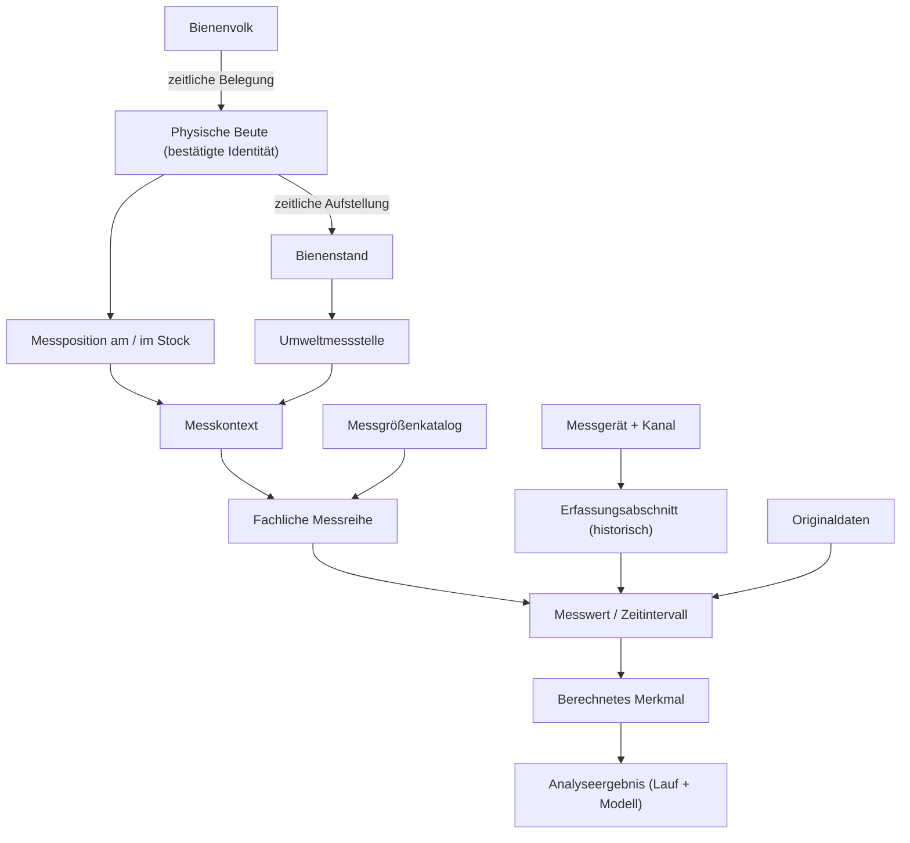

# Fachentwurf 0.1: Messreihe, Messkontext, Zeit und Datenqualität

**Projekt:** Bienen-logger / Radeberger Honig  
**Stand:** 12.10.2026 · **Status:** ENTWURF (G0), **nicht** als Datenbankschema freigegeben  
**Änderungsklasse:** D0 (Dokumentation) · **Nachweis:** T0, Prüfung auf Übereinstimmung mit den bestätigten fachlichen Anforderungen und bestehenden Entwürfen; **kein SQL-, Import-, Server- oder Feldtest**.  
**Primärbezug:** [Messgrößen am Bienenvolk](messgroessen-am-bienenvolk.md), [Anforderungen](anforderungen-datenplattform.md), [ER-Gesamtentwurf 0.1](er-modell-datenplattform-v01.md).

## 0. Status, Architekturgrundsatz und Abgrenzung

- **[BESTÄTIGT]** Ausgangspunkt ist **die fachliche Messgröße am/im Volk** und ihr biologisch/physikalisch richtiger Kontext, **nicht** die Sensorbelegung eines bestimmten beeloggers. Wichtige Kernbereiche: **Gewicht, Temperatur, Luftfeuchte, Schallwellen**. Strukturvibration ist ein eigener möglicher Messbereich.
- **[BESTÄTIGT]** Das System soll allgemeingültig, änderbar und für mehrere Völker und Stände vergleichbar sein. beelogger und BEEP Base sind **alternative** primäre Stockmesssysteme. Umweltmessungen werden Stand/Messstelle zugeordnet; BEEP-Stockkartenereignisse bleiben unabhängig vom Messsystem.
- **[BESTÄTIGT]** Jedes Bienenvolk behält seine Identität; ein Ableger erhält eine neue eigene Volk-ID mit Herkunftsbeziehung.
- **[BESTÄTIGT – 12.10.2026]** Die **physische Beute** ist eine **dauerhaft identifizierbare, vom Volk und Standort getrennte Entität mit Historie**. Die genaue Belegungs-/Standortkardinalität, Beutendefinition bei Komponentenwechsel und SQL-Umsetzung bleiben **[VORSCHLAG]/[OFFEN]**. Details: [Beute–Volk–Stand: Fachentwurf 0.1](beute-volk-stand-beziehungen-v01.md).
- **[VORSCHLAG]** Eine fachliche Messreihe beschreibt **was, wo und nach welcher Semantik** über die Zeit beobachtet wird. Gerät, Kanal und Sensor werden zeitabhängig als technische Herkunft angehängt, **nicht** als fachliche Identität der Reihe.
- **[OFFEN]** Konkrete Wertebereiche, Kalibriertoleranzen, Datenraten, Aufbewahrungsfristen und BEEP-Exportformate. Unbekannte Details nicht erfinden.

**Begriffe:** `measurement_quantity` = Messgröße; `measurement_context` = physischer/biologischer Bezug und Position; `observation_series` = fachliche Reihe; `acquisition_segment` = zeitlicher Abschnitt einer technisch einheitlichen Erfassung; `observation` = Einzelbeobachtung oder Intervallwert. Dies sind **Arbeitstitel**, keine bereits beschlossenen SQL-Tabellen.

## 1. Fachliche Identitäten und Beziehungen

### 1.1 Volk, Beute, Bienenstand

**[BESTÄTIGT]** Drei eigenständige, dauerhaft interne **fachliche Identitäten** sind erforderlich; **[VORSCHLAG]** sind die konkreten Tabellennamen und Ausgestaltungen:

| Identität | Was sie bezeichnet | Typische Lebensdauer/Änderung |
|---|---|---|
| `colony` | biologische/betriebliche Identität eines Volkes | Ableger: neue ID; Wechsel von Beute, Stand und Logger: **gleiche Volk-ID** |
| `hive` | physische Beute bzw. Stockeinheit | kann Zargenwechsel, Reparatur, Ortswechsel oder andere Völker erleben; **Beutenkonfiguration** ändert sich |
| `apiary` | Bienenstand | beherbergt über die Zeit Beuten und Völker, kann Umweltmessstellen haben |

**[VORSCHLAG]** Zwei historische Beziehungen statt dauerhafter Felder `colony.hive_id` und `hive.apiary_id`:

- `colony_hive_occupancies`: `colony_id`, `hive_id`, `valid_from`, `valid_to`, Status und Ereignisreferenz; im normalen Modell gleichzeitig höchstens eine aktive Beute pro Volk und höchstens ein aktives Volk pro Beute. **Sonderfälle/technische Ablegerkästen offen.**
- `hive_apiary_placements`: `hive_id`, `apiary_id`, `valid_from`, `valid_to`; die Standortzuordnung des Volkes wird **bei belegter Beute aus diesen Beziehungen abgeleitet**.

**Abgleich mit bisherigem ER-Entwurf:** Dort ist `colony_placements` als direkte Volk-Stand-Historie vorgesehen. **[OFFEN / Strukturentscheidung]** Eine direkte Standzuordnung kann für Völker ohne bekannte Beute oder historische Lücken erforderlich sein. Es darf **keine widersprüchlichen, unabhängig editierbaren parallelen „Wahrheiten“** zwischen direkter und abgeleiteter Standzuordnung geben. Vorschlag: Beutenbelegung als Primärnachweis bei bekanntem Hive, direkte Volk-Stand-Zuordnung nur als klar gekennzeichneter **Ersatznachweis**, mit Prioritäts-/Konfliktregel.

**Motivation:** Gewichtsreihen gehören zunächst physisch zu einer **Beute**. Ein Volk kann dieselbe Beute weiter nutzen, sie wechseln oder sich teilen; der biologische Verlauf wird durch zeitliche Joins konstruiert. Fütterung, Zargenwechsel und Honigernte dürfen nicht als direkt gemessene Bienenmasse bezeichnet werden.

### 1.2 Messobjekt/Position

**[VORSCHLAG]** `measurement_context` referenziert genau **ein primäres physisches Ziel** aus einer geprüften Zieltypmenge:

- `hive`: gesamte Beute (insbesondere Gewicht);
- `hive_position`: definierter Bereich **der Beute** (Brutraum, Wabengasse, Deckelraum, Wand, Flugloch), mit dokumentierter Tiefe/Höhe/Geometrie soweit bekannt;
- `apiary_position`: Wetter-/Boden-/Mikroklimamessstelle am Stand; Bodentiefe und Montagehöhe optional;
- `device_internal`: MCU-Temperatur, Akkuspannung und andere Gerätetelemetrie (**nicht** als biologische Volkstemperatur);
- `colony_direct` nur, wenn eine Beobachtung **tatsächlich** unmittelbar auf das Volk bezogen ist (z. B. dokumentierter imkerlicher Befund). Bei physischen Stockmessungen standardmäßig **Beute/Position** verwenden.

In einer **SQL-Entscheidung** sind referenziell gesicherte Zieltypen (z. B. getrennte FK-Felder mit XOR-Regel oder typisierte Kontextuntertabellen) gegenüber einem unvalidierten `target_type, target_id`-Paar vorzuziehen. Die genaue Implementierung bleibt offen.

**Verknüpfungsregel:** Eine Wetterreihe gehört *nicht* zu jedem einzelnen Volk. Zur Auswertung `Volk zu Zeitpunkt t` wird die passende Umweltmessung über `Volk → (Beute) → Stand → Umweltmessstelle` **und Messzeit** zugeordnet.

## 2. Anatomie einer fachlichen Messreihe

**[VORSCHLAG]** Eine `observation_series` ist die logische fortlaufende Reihe einer definierten **Messgröße + Messkontext + Beobachtungssemantik**. Sie ist **nicht** die Folge einer Logger-ID oder eines festen Kanalnamens.

| Identitäts-/Definitionsmerkmal der Reihe | Beispiele / Bedeutung |
|---|---|
| `series_id` | dauerhafte interne ID |
| `quantity_id` | Temperatur, Gesamtmasse der Beute, relative Feuchte, akustische Bandenergie usw. |
| `context_id` | eindeutiger physischer Messkontext / Messposition |
| `observation_kind` | Punktmessung, Intervallmittel, Intervallmaximum, Intervallsumme, kumulierter Zähler, Signalfeature |
| `temporal_support` | Zeitpunkt oder Intervallsemantik inkl. nominaler Fensterdefinition, falls fachlich erforderlich |
| `canonical_unit` | °C, %, kg, mm/h, m/s, Hz, dBFS usw., aus `measurement_quantity` |
| `semantic_protocol_version` | dokumentierte Definitionsversion, z. B. welcher Bereich unter „Brutraum“ verstanden wird |
| `origin_policy` | zulässige Quellen/Qualitätsregeln: direkt gemessen, bereits im Quellsystem korrigiert, eigenständig berechnet |
| `comparison_class` | optional: für welche fachlich geprüfte Vergleichsgruppe diese Reihe geeignet ist |

**Wichtige Trennung:** Bei mehreren technischen Geräten, die nach einem Wechsel dieselbe physikalische Messgröße an **derselben** Position erfassen, *kann* die fachliche Reihe fortgesetzt werden. Der Sensorwechsel bildet aber eine zeitliche Abschnittsgrenze und wird in Analysen als möglicher Sprung sichtbar.

**[OFFEN]** Ob bei einer starken Änderung der Messposition (Sensor von Brutraum nach Deckelraum) eine neue `series_id` angelegt oder eine neue Kontextrevision erfasst wird. **Empfehlung:** Neue fachliche Reihe bzw. neuer Kontext; **nicht** heimlich weiterführen.

### 2.1 Erfassungsabschnitte: Sensor-/Firmwarewechsel nicht mit Serienwechsel verwechseln

`acquisition_segments` (VORSCHLAG) verbindet eine fachliche Reihe zeitlich mit konkreten Quellen:

| Attribut | Aufgabe |
|---|---|
| `segment_id`, `series_id` | bestimmter technischer Abschnitt einer Reihe |
| `valid_from`, `valid_to` | Gültigkeitszeitraum, UTC, Beginn inklusive / Ende exklusive |
| `device_assignment_id`, `sensor_installation_id?` | welche Messhardware war zugeordnet? Physische Sensor-ID darf unbekannt sein |
| `ingest_profile_id`, `channel_mapping_id?` | welcher Firmware-/Decoder-/Importpfad und welcher Quellkanal? |
| `calibration_revision_id?`, `processing_revision_id?` | Korrektur-, Skalen- und Signalverarbeitungsdefinition |
| `continuity_flag` / `change_reason` | Änderung erfasst, Vergleichbarkeit danach geprüft/nicht geprüft |

**[VORSCHLAG]** Innerhalb **einer fachlichen Messreihe und eines primären Erfassungspfads** sollten gültige Segmente nicht unkontrolliert überlappen; redundante Quellen oder parallele Messungen benötigen explizite Konflikt-/Prioritätsregeln. Für zwei Mikrofone an zwei verschiedenen Positionen entstehen dagegen zwei Kontexte und zwei Reihen.

## 3. Einzelbeobachtung und Zeitmodell

### 3.1 Beobachtung ist nicht immer „Zahl + Zeitpunkt“

`observations` (VORSCHLAG) sollte die folgenden Inhalte fachlich abbilden können:

| Eigenschaft | Bedeutung |
|---|---|
| `observation_id`, `series_id`, `segment_id?` | eindeutige Version einer gemessenen oder berichteten Beobachtung |
| `observed_at_utc?` | Referenzzeitpunkt, nur bei Punkt-/repräsentativen Messungen |
| `window_start_utc?`, `window_end_utc?` | belegter Zeitraum bei Aggregaten; **nicht** aus `observed_at` erraten |
| `value_numeric?` / typisierte Wertart | Zahl, Status, diskreter Code, Vektor oder externe Signalreferenz, je nach Art; **kein generischer unkontrollierter JSON-Mischwert** |
| `original_unit`, `canonical_unit` | Quell- und Zieleinheiten mit dokumentierter Umrechnung |
| `source_value_id?`, `source_record_id?` | unveränderliche Herkunft; kann bei mehreren Eingangswerten eine eigene Provenienzkante erfordern |
| `quality_assessment_id` | Fachbedeutung, Sensorfunktion, Zeitpunkt, Verarbeitung getrennt prüfen |
| `revision_id`, `supersedes_id?` | fachliche Neubewertung/Korrektur statt stilles Überschreiben |

**[VORSCHLAG]** Eine Primärbeobachtung hat genau **eine** klar definierte Zeitstütze: Punkt oder (nicht leeres) Intervall `[start, end)`; für Intervallbeobachtungen kann zusätzlich ein eindeutig dokumentierter `representative_time` angezeigt werden. Der genaue SQL-CHECK ist erst in der DDL-Phase festzulegen.

**[VORSCHLAG]** Fehlender Wert wird **nicht** als `0` gespeichert. Datenlücken können über erwartete Messzyklen und separat erzeugte Verfügbarkeits-/Qualitätsereignisse festgestellt werden.

### 3.2 Quelle, Empfang, Import und Änderungszeit

| Zeittyp | Beispiel | Warum notwendig |
|---|---|---|
| `source_measured_at` | tatsächlicher/behaupteter Gerätemesszeitpunkt | biologisch relevante Zuordnung; ggf. unsicher |
| `received_at` | Annahme durch TTN/BEEP oder den lokalen Webhook | Funkverzögerung, Ersatzzeit bei unzuverlässiger Geräteuhr |
| `imported_at` | erster Import in zentrale DB | Nachholimporte, Audit |
| `interpreted_at` | Erzeugung einer fachlich normalisierten Beobachtung | spätere Mapping-/Kalibrierkorrekturen |
| `valid_time` | Zeitraum, in dem Sensor-, Kanal-, Beuten- oder Standzuordnung galt | damaligen physischen Kontext rekonstruieren |
| `recorded_at` | Zeitpunkt der Registrierung/Änderung einer Zuordnung | Unterscheidung zwischen damals bekanntem und nachträglich korrigiertem Wissen |

**[VORSCHLAG]** Bei historisch korrigierten Zuordnungen ist zumindest eine **Änderungs-/Audit-Historie** notwendig (vereinfachte Bitemporalität). Die eigentliche Beobachtung wird anhand des **nachweisbaren Messzeitpunkts** ihrem damaligen Kontext zugeordnet; bei unsicherer Gerätezeit bleibt die Zuordnung unsicher. Die derzeit dokumentierte S2120-Station verwendet TTN-`received_at` mangels eigener Messzeit. Der bekannte beelogger-M.40-Originalpfad hat lokale DST-Probleme; nicht durch Umbenennung einer Zeitspalte als „geprüft UTC“ deklarieren.

## 4. Was die vier Kernmessbereiche als Kontext brauchen

| Messbereich | Fachliche Reihe | Zusätzliche obligatorische Semantik vor wissenschaftlichem Vergleich |
|---|---|---|
| **Gewicht** | `hive_total_mass`, kg, Bezug auf **Beute** | Tara, Art der Waage, Korrekturstatus, Zargen-/Beutenwechselereignisse, Repräsentationsart absolut/Änderung |
| **Temperatur** | `temperature`, °C, Bezug auf **Beutenposition** bzw. Außenmessstelle | Position, Medium, Messpunktbeständigkeit, zeitliche Auflösung |
| **Feuchte** | `relative_humidity`, %, an Messposition | Position plus zeitlich/örtlich passende Temperatur, damit Taupunkt/absolute Feuchte berechnet werden kann |
| **Schall** | Roh-Luftschallsegment **oder** gespeichertes akustisches Merkmal | Mikrofonposition, Samplingfrequenz, Aufnahmelänge, Filter/Frequenzband, Pegelbezug, Verarbeitungsversion |
| **Vibration** | strukturgebundene Beschleunigung bzw. Schwingungsmerkmal | Ankopplung, Achsen, Montageposition, Frequenzband/Verarbeitung; **nicht** mit Luftschall mischen |

### 4.1 Gewicht und Eingriffe

**[VORSCHLAG]** `hive_configuration_events` dokumentiert neben Stockkartenereignissen physische Änderungen: Beuten-/Zargenbestand, neue Waage/Tara, Fütterung, Ernte, Umstellen usw., mit Ereigniszeitpunkt und Herkunft. Solche Ereignisse können Gewichtssprünge erklären, dürfen aber **nicht** automatisch als einzige Ursache behauptet werden.

Eine reine Gewichtskurve **misst nicht direkt** Honigertrag, Volksstärke oder Futterverbrauch; diese dürfen nur als **abgeleitete Schätzungen** mit Berechnungsprotokoll auftreten.

### 4.2 Schall: Rohsegment und FFT-Merkmal

**[VORSCHLAG]** Zweistufige Struktur:

- `signal_segments`: optional vorhandene zeitlich begrenzte digitale Audio-/Beschleunigungsaufnahmen; Start/Ende, Samplingrate, Bitauflösung, Achsen/Kanäle, physische Messposition, Kalibrierstatus und optional geschützte Artefaktreferenz mit Hash.
- `signal_features`: Peakfrequenz, Bandenergien, RMS, spektrale Kennwerte usw. mit Featuredefinition und DSP-Version; kann auf einem `signal_segment` beruhen **oder** direkt vom Gerät als fertig berechneter Wert geliefert werden.

**[VORSCHLAG]** Datenbankfeatures dürfen **nicht voraussetzen**, dass eine Roh-Audiodatei existiert. Insbesondere ein beelogger-FFT-Wert ist keine Audiodatei. Relative Pegel, dBFS und kalibrierte dB SPL sind unterschiedliche Darstellungs-/Messarten und dürfen nicht ohne Umrechnungsvorschrift vermengt werden.

**[OFFEN]** Aufbewahrungsdauer, Datenschutz (mögliche Sprachaufzeichnung bei Außenmikrofonen), Rohdatenmenge, FFT-Banddefinition und tatsächliche Sensordatenraten.

## 5. Datenqualität: mehrere Achsen statt „ok/fehler“

**[VORSCHLAG]** Qualität als **mehrdimensionale** Bewertung; nicht jedes Problem führt zur pauschalen Verwerfung:

| Qualitätsdimension | Beispielwerte (Arbeitsbegriffe) | Analytische Folge |
|---|---|---|
| `time_quality` | `device_sync_confirmed`, `receive_time_proxy`, `clock_ambiguous` | Zeitliche Zuordnung ggf. unsicher |
| `semantic_quality` | `mapped_confirmed`, `mapped_inferred`, `unresolved` | Unbekannte Kanäle **nicht** als Temperatur/Feuchte analysieren |
| `sensor_quality` | `calibrated`, `calibration_unknown`, `sensor_error`, `out_of_range` | Filter / Ausschluss / Qualitätsgewicht |
| `processing_quality` | `source_corrected`, `reprocessed`, `precision_limited`, `decoder_warning` | Herkunft und Vergleichbarkeit klar darstellen |
| `context_quality` | `location_verified`, `location_inferred`, `position_unknown` | z. B. Brutraumtemperatur nicht automatisch unterstellen |
| `availability` | `present`, `missing_interval`, `duplicate_source` | Datenlücken und wiederholte Uplinks nicht als neue Messung behandeln |

**[VORSCHLAG]** Die Zulassung für eine konkrete Analyse ist eine **versionierte Filterentscheidung** (z. B. „Brutraumtemperatur nur mit verifizierter Position“), nicht ein irreversibler globaler Wahrheitswert. Ein Wert kann für ein Diagramm sinnvoll, aber für eine quantitative Vergleichsstudie ungeeignet sein.

## 6. Herkunft, Korrektur und Datenrevision

```text
Quelle (beelogger | Umweltsensor | BEEP)
   → Import-/Empfangsvorgang
   → unveränderter Originaldatensatz oder referenzierte Originaldatei
   → einzelner Originalfeldwert (auch bei unbekannter physikalischer Bedeutung)
   → fachliche Kanal-/Einheiten-/Zeitinterpretation mit Version
   → Beobachtungsrevision mit Qualität und Messkontext
   → berechnetes Feature und Analyseergebnis mit Eingangs-/Codeversion
   → (optional) explizit freigegebener Datensatz / öffentliche Darstellung
```

- **[VORSCHLAG]** Rohinformationen möglichst unverändert und wiederauffindbar aufbewahren; bei großen Audiodaten ggf. nur geschützte Originaldatei + unveränderliche Prüfsumme/Referenz im DB-Katalog.
- **[VORSCHLAG]** Idempotenz aus quellseitiger Ereignisidentität, Gerätename/-ID, Datenweg, Quellzeit und Payload-Hash **nach dokumentierter Priorität**; **nicht** nur nach Zeit, weil verschiedene legitime Werte denselben Zeitpunkt haben können.
- **[VORSCHLAG]** `observation_revisions` oder immutable `observations` mit `supersedes`: Korrektur von Feldbedeutung, Zeitbasis oder Kalibrierung erzeugt nachvollziehbare **neue Interpretation**. Eine rein technische Zustellwiederholung erzeugt **keine** zweite unabhängige Messung.
- **[VORSCHLAG]** Ein Analyseergebnis referenziert genau den damaligen Feature-/Beobachtungsstand oder eingefrorenen Datensatz-Snapshot; Korrekturen führen bei Bedarf zu **neuen** Ergebnissen mit Verweis auf die alten.
- **[BESTÄTIGT]** BEEP-Stockkartenereignisse dienen als unabhängige imkerliche Kontextinformation; externe BEEP-IDs werden mit internen Volk-IDs historisch zugeordnet. BEEP-Base-Daten werden **nicht** so dargestellt, als gingen sie direkt an den lokalen Server.

## 7. Fachliche Beziehungen als Ablauf



**Hinweis:** Dieses Diagramm beschreibt fachliche Beziehungen, **nicht** exakte SQL-Cardinalities. Eine Messreihe kann zudem ausschließlich als geplante Messgröße existieren, solange noch keine Beobachtung vorliegt.

## 8. Beispiele und erwartetes Modellverhalten (synthetische Szenarien)

### A. Sensor wird ersetzt

- `hive H1`, Messposition „Brutraum links“, `temperature` bleibt als fachliche Messreihe identifizierbar.
- Vor dem Tausch `acquisition_segment 1` (Sensor A), danach `segment 2` (Sensor B).
- Sensorwechsel ist ein Marker im Analysekontext; Daten vor dem Wechsel behalten ihren Ursprung.

### B. Volk wechselt Beute, Waage bleibt an der alten Beute

- `colony C1` belegt bis Zeitpunkt `t` Beute `H1`, danach `H2`.
- Waagenmessungen von `H1` nach `t` gehören **nicht** automatisch zum biologischen Verlauf von `C1`; ohne Messung von `H2` entsteht eine Lücke.
- Wenn `H1` danach ein anderes Volk beherbergt, bleiben die physischen Gewichtsmessungen bei `H1` und werden per zeitlichem Join zum neuen Volk zugeordnet.

### C. Gewichtsänderung durch Eingriff

- Ein Stockkartenereignis „Honigernte“ tritt im betreffenden Zeitfenster auf.
- Der Datenbankwert bleibt „Gewichtsänderung der Beute“. Eine geschätzte entnommene Honigmasse darf nur als **eigenes berechnetes Ergebnis** mit Methode/Ereignisbezug gespeichert werden.

### D. Akustik ohne Rohsignal

- Ein beelogger liefert nur **FFT-Peakfrequenz** und **relativen Peakpegel**.
- Die Messwerte werden als `signal_features` mit `input_kind=device_computed`, Einheit und Quell-/Firmwareversion geführt.
- **Kein** erfundenes `signal_segment`, keine Behauptung einer Audiodatei oder kalibrierten dB-SPL-Messung.

### E. Gleiche Größe, andere Position

- Brutraum: 34,6 °C; Beutendeckel: 24,3 °C (rein synthetisches Beispiel).
- Zwei unterschiedliche Reihen/Kontexte trotz einheitlicher Größe `temperature`.
- Ein Vergleich „Brutraumtemperatur“ filtert nicht unbesehen die Deckeltemperatur hinzu.

### F. Standübergreifender Vergleich

- Zwei Völker an unterschiedlichen Ständen werden für ein Beobachtungsfenster gewählt.
- Die Abfrage löst `colony → zeitlich gültige hive → apiary → environment` auf und berücksichtigt Messqualität, Position, Zeitabdeckung und vorhandene Kanäle.
- Wenn ein Volk kein Mikrofon besitzt, gilt das Merkmal als **nicht vorhanden**, nicht als Frequenz oder Pegel `0`.

## 9. Prüfmatrix: Was muss die spätere Implementation können?

| ID | Akzeptanzprüfung | Erwartung |
|---|---|---|
| MR-01 | Gewicht wird gemessen, obwohl keine Volk-ID zugeordnet ist | physisch bei Beute speicherbar; biologischer Bezug unbekannt |
| MR-02 | Ein Volk zieht in eine andere Beute | keine falsche Gewichtskontinuität |
| MR-03 | Eine Beute wechselt den Bienenstand | Umweltkontext des Messwertes zeitlich korrekt |
| MR-04 | DS18B20 wird ausgetauscht | gleiche fachliche Größe, neuer Erfassungsabschnitt |
| MR-05 | Temperaturfühler wird an andere Position verlegt | neuer Messkontext oder sichtbar geänderte Kontextrevision |
| MR-06 | Luftfeuchte mit anderer, nicht korrespondierender Temperatur | keine unbelegte Taupunktberechnung |
| MR-07 | FFT-Features ohne Audio-Rohdaten | möglich, ohne synthetische Audiodatei |
| MR-08 | Mehrere Signalarten Luftschall/Strukturvibration | getrennte Modalität, keine implizite Gleichsetzung |
| MR-09 | Unklarer Quellkanal / BEEP-API-Feld | Rohinformation speicherbar; keine erfundene Messgröße |
| MR-10 | Ein Sensorwert ist nur in Empfangszeit bekannt | Zeitqualität explizit „proxy“ |
| MR-11 | Identischer TTN-Uplink trifft erneut ein | idempotent, keine doppelte Beobachtung |
| MR-12 | Kalibrierung nachträglich korrigiert | alte Beobachtungsrevision bleibt nachvollziehbar |
| MR-13 | Datenlücke | kein künstlicher Nullwert |
| MR-14 | Wechsel von beelogger zu BEEP Base | eindeutige zeitliche Primärmesstechnik, Volk-ID konstant |
| MR-15 | Standübergreifende Clusteranalyse | nur semantisch/zeitlich vergleichbare Features |
| MR-16 | Veröffentlichung | nur explizit freigegebene Daten, keine Stockkarten-Rohtexte / sensiblen Standortdaten |

**Teststatus:** ausschließlich **konzeptionelle Akzeptanzfälle**, **keine automatisiert oder am Gerät bestandenen Tests**.

## 10. Offene fachliche Entscheidungen – zur gemeinsamen Abnahme

1. **Beute als eigenständige Entität: BESTÄTIGT (12.10.2026).** Die konkrete Definition der Beutenidentität bei vollständigem Umbau und der Zuschnitt von Boden, Zargen und Deckel als optionale Baugruppen bleiben **OFFEN**; [Beute–Volk–Stand-Fachentwurf](beute-volk-stand-beziehungen-v01.md).
2. **Volk-Stand-Zuordnung:** Bei vorhandener Beutenhistorie aus dem Standort der Beute ableiten; Regeln für historische Unvollständigkeit festlegen.
3. **Identität einer fachlichen Reihe:** Beim reinen Sensortausch weiterführen, beim Positionswechsel grundsätzlich neue Reihe; Grenzfälle/Parallelmessungen entscheiden.
4. **Messpositionstaxonomie:** standardisierte Bereiche plus optionale frei dokumentierte Lage; Typ „Brutraum“ nicht mit „tatsächlich im Brutnest“ gleichsetzen.
5. **Zeitintervallregeln:** timestamp vs. window, nominale Samplingdauer, verspätete Werte und Zeitunsicherheit.
6. **Akustik:** optional Rohsignale archivieren? Falls ja, Formate, Speichergrenze, Datenschutz, Kalibrierung, Metadaten und DSP-Versionierung.
7. **Datenqualität:** Qualitätsdimensionen und Regeln zur Zulassung pro Analyseverfahren.
8. **Revisions-/Snapshotmodell:** technisch nachprüfbare Provenienz bis zum veröffentlichten Analyseergebnis.

**Nicht erforderlich für den allgemeinen Entwurf:** Die momentane Sensorbelegung von `beelogger1`; die [Ist-Inventur](ist-inventur-beelogger1.md) bleibt spätere Integrationshilfe.

## 11. Nächste fachliche Phase

**Entscheidungsfortschritt 12.10.2026:** Die eigene Beutenidentität ist **verbindlich beschlossen**. Das noch nicht freigegebene [Fachmodell zu Beute, Volk und Bienenstand](beute-volk-stand-beziehungen-v01.md) führt Sonderfälle (Ableger, Vereinigung, leere Beute, Stand- und Gerätewechsel), zeitliche Kardinalitäten sowie Konflikte zwischen direkter und abgeleiteter Standhistorie zusammen. Diese Regeln als Nächstes fachlich prüfen; erst nach ihrer Abnahme SQL-DDL/Migration.

**Keine Änderung an Server, Datenbank, Firmware, BEEP-Anbindung oder öffentlichen Diensten.**
