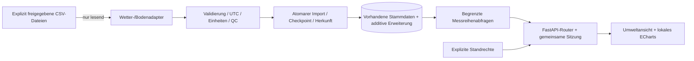

# ADR-0004: erste Umwelt-Datenstrecke im bestehenden Teststack

**Status:** vorgeschlagen; Betreiberentscheidung im R0-Gate ausstehend

**Datum:** 2026-10-17 · **Autor:** Codex · **Entscheidend:** Maintainer

**Referenz:** [R0-Bericht](../../testberichte/2026-10-17-refactoring-r0.md),
Refactoring-Auftrag R1/A-01/A-02/A-04/A-05, ADR-0003.

## Ausgangslage und Optionen

Auf `034c9e1d31612679dcc3cc15155208b9c0c82e72` sind PHP-Dateieingänge und eine
FastAPI-Stockkarte vorhanden. Die Umweltseite liest keine Zeitreihen; die
Anmeldung ist auf die Stockkarte begrenzt. Die bestehenden Stammdaten und
SQL-Zuordnungen werden weiterverwendet. Neue RF-Befunde stehen im
[Register](../../testberichte/befunde.md#refactoring-webplattform-r0).

FastAPI/PostgreSQL, unveränderte PHP-Empfänger und Apache ECharts sind bereits
vorgegeben. Dieser Vorschlag entscheidet weder eine BEEP-Umschaltung noch einen
Vue-Umbau. Die beschriebenen neuen Module, Tabellen und Routen sind geplant.

| Option | Nutzen | Nachteil |
|---|---|---|
| Vollständig neuer Frontend-/Backend-Stack | Einheitliche neue Struktur | Großer unbewiesener Migrationsumfang vor erster Umweltkurve. |
| CSV direkt an Browser ausliefern | Wenig Anfangscode | Umgeht PostgreSQL, zentrale Rechte und Importprovenienz. |
| Vertikale Erweiterung mit getrennten Modulen | Ein prüfbarer Weg durch echte Komponenten, Verträge erhalten | Auth-/Cookie- und Messhistorienvertrag ausdrücklich erweitern. |

## Vorgeschlagene Entscheidung und Modulgrenzen

Die dritte Option in einem separaten R1-PR nach R0-Freigabe umsetzen:

| Geplante Verantwortung | Abgrenzung |
|---|---|
| Quelladapter | Spalten, Zahlen, UTC und Rohreferenzen; kein HTTP, kein Schreiben in Quellen. |
| Domäne/Normalisierung | Einheit, Zeitqualität, Position, gültige Kanalzuordnung, QC; keine Browserzustände. |
| Importdienst/Repository | Transaktion, Idempotenz, Checkpoint und Backfill; kein Eingriff in PHP-Erfassung. |
| Authentifizierung/Rechte | Vorhandene Sitzung, explizite Standrechte, Widerruf; keine Messwertformatierung. |
| Router/DTOs | Fenster, Paginierung, Fehler; keine freie Dateipfadauswahl durch Clients. |
| Umwelt-Frontend | Auswahl, ECharts, Berlin-Tooltip, Einheiten, Lücken, Aktualisierung; keine eigene Entitätenliste. |

Dieselbe FastAPI-App und PostgreSQL verwenden. Ein explizites CLI bzw. ein
begrenzter periodischer Import reicht zunächst; kein neuer Broker. Vorhandene
Stockkarten-Routen/DTOs erhalten. Auth und gemeinsame SQL-Abfragen nur soweit
für R1 erforderlich extrahieren; die Stockkarte nicht insgesamt neu schreiben.

## Quellen-, Datenbank- und API-Vertrag

- Lokale, nicht versionierte Konfiguration ordnet freigegebene Dateien
  vorhandenen Stand-/Geräte-IDs zu. Keine Zuordnung durch zufällig gleiche
  Namen. Nur eng begrenzte Read-only-Mounts, keine kompletten Serververzeichnisse.
- S2120-Profil aus `we_kopf()`, Bodenprofil aus dem Auftragsheader. Ein
  Boden-Gerät mit getrennten Kanälen/Positionsmetadaten für 5/20/50 cm.
- Leere Zellen bleiben fehlend, 0 bleibt 0. Ungültige/nicht endliche Zahlen,
  Zeitstempel und Teilzeilen mit Rohreferenz melden. Unbekannte Spalten
  erhalten statt still interpretieren. Kein naiver Zeitstempel als belegtes UTC.
- S2120-Zeit als TTN-Empfangszeit kennzeichnen. Bedeutung von Boden-`time_utc`
  vor Echtdatenabnahme bestätigen; nicht pauschal Gerätezeit nennen.
- Quell-ID, Dateireferenz, Zeile/Offset, Record-Hash, Importzeit und Parser-/
  Mappingversion erhalten. Dateizeile allein ist keine stabile Ereignis-ID.
  Boden-`message_id` nur bei belegter Eindeutigkeit nutzen. S2120-CSV ohne
  explizite Ereignis-ID: widersprüchliche Records sichtbar erhalten; keine
  automatische Löschung als Dublette oder vermeintliche Korrektur.
- Checkpoint und neue Datensätze atomar committen; Mehrfachimport,
  Abbruch/Restart, verkürzte/ersetzte Dateien und Backfill testen.
- Additive versionierte Migration auf Schema 0.3 + SK-001/SK-002; nie
  `schema.sql` erneut anwenden. Neue Objekte für Importherkunft/Checkpoint,
  Messrevisionen und Standrechte. Genaue DDL mit Altbestandstest und
  Migrationskennung im R1-PR prüfen; hier noch keine SQL-Freigabe.
- `stand`, `geraet`, `messstelle`, `kanal`, `messgroesse` bleiben kanonisch.
  `messwert` darf eine kontrollierte aktuelle Projektion bleiben, wenn alle
  Ursprungsrecords/Korrekturrevisionen erhalten und Leser kompatibel sind.
  Alternativ expliziter Revisions-Lesepfad; keine zweite Stammdatenwelt.
- Kanalgültigkeit beim Schreiben und Lesen erzwingen. Kalibrierwechsel als
  neuer Abschnitt/Revision; keine unerkennbare Änderung alter Werte.
  Unsichere Zuordnungen kennzeichnen; ungeprüftes Gewicht nicht als kg ausgeben.
- Zunächst begrenzte Rohwertabfragen. Spätere Verdichtungen separat testen:
  `rain_mm` bei unbekanntem Reset nicht summieren/differenzieren, Windrichtung
  nicht arithmetisch mitteln, keine Interpolation/Nullen über Datenlücken.

Neue lesende Pfade z. B. `/api/v1/umwelt/staende`, `/kanaele`, `/messreihen`.
Endgültige DTOs/Pfade in R1 mit OpenAPI/Vertragstests versionieren. Begrenzte
UTC-Fenster, Seiten-/Punktlimits, stabile Sortierung, Einheiten, Quellen-/
Kanal-ID, Zeitqualität und QC ausgeben. Unbekannte/nicht freigegebene Stände
liefern keine Daten. Standrecht nicht aus beliebigem Völkerrecht ableiten.

Vorhandene Sitzung verwenden. Für Pfade außerhalb `/api/v1/stockkarte` das
Cookie kontrolliert auf `/api/v1` erweitern: Login/Logout entfernen das alte
Pfad-Cookie; keine konkurrierenden gleichnamigen Cookies. Alte Login-/
Stockkartenantworten bleiben kompatibel. Eine einmalige Neuanmeldung beim
Wechsel dokumentieren. CSRF/Origin und Rechteentzug weiter prüfen. Gemeinsamer
sichtbarer Login als R1-Einstieg, vollständige UX-Konsolidierung erst R3.

## Browser, Nachweise und Rückfall

ECharts lokal mit konkreter Version/Lock und Apache-2.0-Lizenzhinweisen
ausliefern; CSP erhalten. Konfiguration aus Kanalmetadaten, keine festen IDs.
Wetter und drei Bodentiefen mit passenden Einheiten/Skalen; inkompatible
Größen in getrennten Spuren. Zeitfenster 24 h/7/30 Tage/frei, Zoom, Legende,
Tooltip, mobile Ansicht und echte Leer-/Fehlerzustände. Ziel im Testbetrieb:
Browserabfrage alle 30 Sekunden, Importintervall explizit konfiguriert;
A-04 misst die tatsächliche Latenz, statt sie lediglich zu behaupten.

R1 erst nach A-01/A-02/A-04/A-05 über echte DB/FastAPI/Caddy/ECharts zur Abnahme
übergeben. Zusätzlich Parsergrenzen, Dubletten, Restart, Dateirechte, DST,
Rechteentzug, Cookie-Wechsel und Erhaltung alter Stockkarteneinträge prüfen.
Synthetische Fixtures sind Testdaten. Echte Messdaten benötigen autorisierte
Kopien und Betreiberprüfung; Cloud-Browser ersetzen keinen physischen LAN-Client.
Der Betreiber hat am 17.10.2026 bestätigt, zunächst synthetische Testdateien
zu verwenden. Dies ist keine Echtdaten- oder Produktivabnahme.

Vor manueller Änderung vorhandener Testdaten: Backup und Restore in eine
separate neue DB, Bestandsinhalte vergleichen. Migration auf Kopie prüfen.
Rollback bevorzugt durch Stoppen von Importer/neuer App und Start der
kompatiblen alten App; zusätzliche Tabellen zunächst erhalten. Keine
automatische Daten-/Volume-Löschung. Exakte getestete Update-/Rollbackbefehle
gehören in R1 und werden hier nicht als bereits verifiziert ausgegeben.

Apache/PHP/TTN/BEEP und Firmware/Hardware unverändert. Kein Deployment und kein
Merge ohne Betreiber. Eigener Code GPL-3.0-or-later, ECharts gesondert mit
Lizenz und Herkunft. Noch keine Betriebsfreigabe oder BEEP-Parität.

## Entscheidung

Noch nicht angenommen. Maintainerentscheidung zum R0-Gate und offene
Quellen-/Rechtezuordnungen festhalten; anschließend R1 implementieren.
