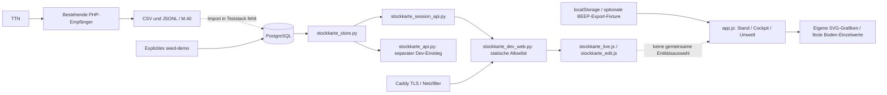

# R0: Bestandsaufnahme der Bienenlogger-Webplattform

- **Prüfbericht-ID:** RF-R0-20261017
- **Geprüfter Code:** `034c9e1d31612679dcc3cc15155208b9c0c82e72`, Branch `test/thinkstation-lan-20261017`.
- **Auftragsfassung:** [vollständiger Refactoring-Auftrag](https://github.com/impyer/bienen-lora-logger/blob/69a9fe1441c1ee4f55be0bd3e87e138466849bb2/docs/entwicklung/CODEX-REFACTORING-AUFTRAG-2026-10-17.md), Commit `69a9fe1441c1ee4f55be0bd3e87e138466849bb2`.
- **Arbeitsbranch:** `refactor/r0-bestandsaufnahme-20261017`, vom genannten Code-Commit abgezweigt. `main` zeigte bei der Inventur auf `66a3ba26b49a7ccd53d94436708f6bd124b3e4da`; es ist nicht die Teststack-Basis.
- **Prüfung:** Codex, 17.10.2026 UTC; T0/T1/T2, keine unabhängige Betreiberabnahme.
- **Änderung:** D0, ausschließlich Analyse, vorgeschlagene Architekturentscheidung und Register. Betroffene Gates: R0 und G0/G1; kein Rewrite, keine R1-Implementierung und keine Betriebsfreigabe.
- **Umgebung:** isolierte Debian-13-Cloud; GCC 14.2, Node 24.19.0, Python 3.12.14, PostgreSQL 17.11, psycopg 3.2.13, FastAPI 0.143.3, Starlette 1.8.0, Pydantic 2.14.1, uvicorn 0.54.0, httpx 0.28.1, argon2-cffi 25.1.0, Playwright 1.56.1, Chromium 155.0.8059.79, Caddy 2.6.2, PHP 8.4.26/cURL und libfaketime 0.9.10. Abweichung zu CI: dort PostgreSQL 16 und Node 20/22; hier keine Gleichheit der Laufzeitversionen behauptet.

## Ergebnis und Reichweite

Die Plattform besitzt brauchbare, getestete Bausteine für PHP-Empfang und eine
revisionsfähige Stockkarte. Eine zusammenhängende Umwelt-Datenstrecke existiert
auf dieser Basis nicht. Ein erfolgreicher Login oder bestehende grüne
Stockkartentests beweisen sie nicht. Die R1-Kernprüfung war vor der ersten
Repository-Änderung reproduzierbar **FAIL**.

Die Untersuchung greift nicht auf die ThinkStation, ihre Laufzeitdaten oder
private BEEP-/TTN-Daten zu. Alle schreibenden Proben liefen ausschließlich in
der selbst erzeugten Cloud-Testdatenbank `bienen_test` mit synthetischen Daten.
Die SQL-Grenzfallproben wurden zurückgerollt; der temporäre Browser-Testbenutzer
und seine Sitzung wurden entfernt, beide Testprozesse beendet.

Der aktuelle Befundstand wird ausschließlich im [Befundregister](befunde.md#refactoring-webplattform-r0)
gepflegt. Dieser Bericht hält die Beobachtungen auf dem genannten SHA fest.

## Ist-Architektur und Datenflüsse



| Baustein | Quellbeleg auf dem Prüf-SHA | Aussage |
|---|---|---|
| Wetterempfang | `server/wetter/wetter_eingang.php:60–104`, `wetter_funktionen.php:9–23,59–70` | Authentisierter PHP-Eingang; vollständiges Rohprotokoll und Semikolon-CSV. `zeit_utc` stammt aus TTN-Empfangszeit, nicht aus einem belegten Gerätemesszeitpunkt. |
| LoRa-/M.40-Empfang | `server/lora/`, `server/eigen_anpassen.py` | Eigenständiger kompatibler Dateipfad; kein PostgreSQL-Importer in diesem Teststack. Original/abgeleitete Serverdateien sind beabsichtigte Referenz-/Generatorausgaben. |
| Laufzeitpaket | `deploy/heimnetz-test/compose.yaml:4–70`, `Dockerfile:4–15` | PostgreSQL, FastAPI und Caddy. Keine Quellen-Mounts, kein Importprozess, keine ECharts-Datei. DB und App haben keinen Host-Port. |
| Browser | `prototype/claude-ui/index.html:4–6,19–23`, `app.js:18–47,63–106,117–129,221–225` | Lokale Völker-/Kanaldefinitionen und Offline-Speicherung. Umweltansicht enthält feste Einzelwerte und einen ehrlichen Leerzustand; keine Umwelt-Abfrage. |
| Server-Stockkarte | `stockkarte_live.js:8–12,30–76`, `stockkarte_edit.js` | Eigene Sitzung, Völkerwahl und Bearbeitung im Modal. Die Server-IDs werden absichtlich nicht blind den lokalen Demo-IDs gleichgesetzt. |
| Authentifizierung | `stockkarte_session_api.py:35–157`, Migration `002:7–35` | Secure-/HttpOnly-/SameSite-Cookie, Hash in DB, CSRF und laufend geprüfte Völkerrechte. Standrechte für Umwelt fehlen. Cookie ist auf `/api/v1/stockkarte` begrenzt. |
| SQL-Messmodell | `schema.sql:239–325,356–362` | Messgröße, Gerät, Kanal, Messstelle und zeitliche Gerätezuordnung vorhanden; noch kein vollständiger Import-/Revisionsvertrag für Messwerte. |
| Stockkartenpersistenz | Migration `001:60–146`, `stockkarte_store.py:164ff.` | Append-only-Revisionen, erwartete Revision, Datum/UTC getrennt. Diese Bausteine erhalten. |

### Doppelte und alternative Pfade

1. `app.js` führt lokale Völker und Entwürfe; die Sitzungsschnittstelle führt
   PostgreSQL-Völker. Das sind zwei Identitäts-/Persistenzwelten, nicht zwei
   synchronisierte Ansichten derselben Entität (RF-01/RF-02).
2. `schema.sql:132–183` definiert `merkmal/checkliste/durchsicht`; Migration 001
   ergänzt `sk_kategorie/sk_checkliste/sk_durchsicht`. Die aktive HTTP-API
   verwendet die `sk_`-Tabellen. Kein automatisches Löschen des älteren Modells:
   Konsolidierung erst mit Inventur, Migration und Restore-Nachweis (RF-07).
3. `stockkarte_api.py:110–142` und `stockkarte_session_api.py:185–228` lesen
   Kataloge mit ähnlichem SQL, aber abweichendem DTO (`source` fehlt im
   Sitzungskatalog). Die Bearer-API ist ein separater Entwicklungseinstieg,
   kein nachgewiesen unbenutzter Code. Gemeinsame Abfragen/DTOs schrittweise
   extrahieren; öffentliche Verträge nicht beiläufig vereinheitlichen.
4. `stockkarte_native.js` und `stockkarte_store.py` validieren dieselben
   fachlichen Eingabetypen in verschiedenen Sprachen. Beide Prüfungen sind
   sinnvoll; es fehlt ein gemeinsamer vollständiger Konformitätsdatensatz.
5. `chartSVG` und SQL berechnen beide Tagesreferenz/-bilanz. Die Browserwerte
   stammen aus lokalen Daten, SQL aus dem Datenbankmodell. Künftige Kennwerte
   einmal serverseitig versionieren, mit gemeinsamen Referenzfällen prüfen.
6. Minifizierter Formatter, M.40-Referenz/eigene Fassung und HTML-Einzeldatei
   sind dokumentierte Generator-/Offline-Ausgaben. Ihre Duplikation allein
   begründet keine Entfernung. Für die untersuchten Plattformmodule ist keine
   sichere pauschale Liste löschbaren Codes nachgewiesen.

## Reproduzierte Kernlücke und Dateninvarianten

### A-00: echte Komponenten, fehlende Umweltfunktion

Ein temporärer uvicorn-Prozess bediente `stockkarte_dev_web:app` mit dem
unveränderten Prüfcode und der lokalen PostgreSQL-Datenbank. Ein temporärer
Caddy-Prozess lieferte HTTPS über seine eigene lokale CA. Python prüfte die
Zertifikatskette explizit gegen diese CA. Chromium verwendete für die ihm nicht
installierte Test-CA `ignoreHTTPSErrors: true`: der Browserdurchlauf allein
beweist deshalb kein korrekt eingerichtetes Client-Zertifikatsvertrauen.

Beobachtet, ohne simulierte HTTP-/DB-Antworten:

```json
{
  "https_verified_with_local_ca": true,
  "login_status": 200,
  "colonies_status": 200,
  "authorized_colony_count": 1,
  "environment_api_status": 404,
  "echarts_loaded": false
}
```

Nach Klick auf „Umwelt & Tracht“ erschienen die drei festen Boden-Einzelwerte
und „Noch keine vollständige Umwelt-Zeitreihe“. Die Sollprüfung
`environment_api_status == 200 and echarts_loaded` endete mit AssertionError,
Exitcode 1. Der beispielhafte R1-Pfad `/api/v1/umwelt/staende` ist auf der
Baseline nicht implementiert; zusätzlich bestätigen Route-/Quellprüfung, dass
auch kein anders benannter Umwelt-Messreihenpfad existiert.

Kurze Wiederholung der HTTP-Lücke gegen einen selbst gestarteten lokalen
Teststack: `GET /api/v1/umwelt/staende` liefert 404; in der Browserkonsole ist
`typeof window.echarts` gleich `"undefined"`. Login und Völkerabfrage müssen
separat erfolgreich geprüft werden, damit ein nicht gestarteter Server nicht
mit einer fehlenden Funktion verwechselt wird. Keine produktiven Benutzer
oder Geräte für diese Prüfung einrichten.

Zusätzliche kurze Routenprobe ohne Datenbankänderung (TestClient, **kein**
Ersatz für die oben ausgeführte echte HTTPS-/Browserprobe):

```sh
PYTHONPATH=server/datenbank python3 - <<'PY'
from fastapi.testclient import TestClient
from stockkarte_dev_web import app
with TestClient(app, base_url="https://testserver") as client:
    assert client.get("/").status_code == 200
    response = client.get("/api/v1/umwelt/staende")
    print("Umweltstatus:", response.status_code)
    assert response.status_code == 200, "R1: Umwelt-Datenstrecke fehlt"
PY
```

Erwartung auf der Prüf-Baseline: `Umweltstatus: 404`, AssertionError, Exitcode 1.

### RF-09 / RF-10: SQL-Probe mit Rollback

Folgende Probe ist **nur auf einer eigenen Wegwerf-Testdatenbank** mit Schema
0.3 auszuführen; das Schema hierfür nicht gegen bestehende Daten neu laden:

```sql
BEGIN;
SET LOCAL search_path = bienen, public;
INSERT INTO geraet(name,art) VALUES ('r0-synthetische-sonde','boden');
INSERT INTO messgroesse(code,name,einheit,semantik,verdichtung,achse)
VALUES ('r0-temp','Synthetisch','°C','momentan','mittel','temperatur');
INSERT INTO kanal(geraet_id,quellfeld,messgroesse_code,gueltig)
SELECT id,'temp','r0-temp','[2026-10-01T00:00Z,2026-10-02T00:00Z)'
FROM geraet WHERE name='r0-synthetische-sonde';
INSERT INTO messwert(kanal_id,zeit,wert,zeitqualitaet)
SELECT id,'2026-10-03T12:00Z',12.5,'empfang'
FROM kanal WHERE messgroesse_code='r0-temp';
SELECT zeit,wert FROM messwert_bezug WHERE messgroesse_code='r0-temp';
-- IST: eine Zeile, 12.5, obwohl außerhalb der Kanalgültigkeit.
UPDATE kanal SET faktor=2 WHERE messgroesse_code='r0-temp';
SELECT zeit,wert FROM messwert_bezug WHERE messgroesse_code='r0-temp';
-- IST: dieselbe historische Messung erscheint jetzt als 25.
ROLLBACK;
```

Der Datenbankaufruf hat beide Beobachtungen bestätigt. Eine fachliche
Schreib-/Leseschicht muss Kanalgültigkeit erzwingen und Kalibrierwechsel als
neuen Abschnitt/Revision behandeln. Keine Behauptung, dass solche falschen
Daten bereits auf der ThinkStation gespeichert wurden. R0 verändert diese
SQL-Objekte nicht.

## Testmatrix dieser Iteration

Alle folgenden neu ausgeführten Prüfungen beziehen sich auf den vollständigen
Code-SHA oben; die R0-Dokumentation verändert den geprüften Code nicht.

| Prüfung / Befehl | Ergebnis | Aussagekraft / Grenze |
|---|---|---|
| `SERVER_UHR='2026-10-09 05:00:00' BROWSER_PFLICHT=1 bash tests/alle_tests_linux.sh` | PASS; Zeitlogik 70/70, FFT 32/32, Funkformat 303/303; Formatter 14/14 + 14/14 + 12/12; PHP 66/66 + 41/41; LoRa 82/82, Wetter 29/29; Simulationen abgeschlossen | Host-/PHP-Kompatibilität; kein neuer Umweltimport. |
| `python3 tests/datenbank/test_stockkarte_persistenz.py` | PASS, 24 Integrationsprüfungen | Echte PostgreSQL-Transaktionen, Revisionen und Konflikte; synthetische Daten. |
| `python3 tests/datenbank/test_stockkarte_api.py` | PASS; Skript meldet keine Gesamtanzahl | FastAPI TestClient + echte DB; keine Browser-/Netzwerkstrecke. |
| `python3 tests/datenbank/test_stockkarte_session.py` | PASS, 61 Prüfungen | Auth, ACL, CSRF, Entzug/Widerruf und Revisionen; TestClient. |
| `node tests/server/test_stockkarte_native.js` | PASS, 14 | Domänenlogik. |
| `node tests/server/test_stockkarte_values.js` | PASS, 14 | Werte/Typen. |
| `node tests/server/test_beep_catalog_adapter.js` | PASS, 17 | Synthetische Katalogreferenz; keine vollständige autorisierte BEEP-Taxonomie. |
| `node tests/server/test_stockkarte_catalog_editor.js` | PASS, 19 | Lokaler Katalog. |
| `test_claude_ui.js`, `test_native_stockkarte_browser.js`, `test_stockkarte_catalog_browser.js` unter `tests/server/` | PASS; jeweils vorhandene modulare/Offline-Prüfungen abgeschlossen | Browser-Bedienbarkeit; keine reale Messreihe. |
| `node tests/server/test_stockkarte_live_browser.js` | PASS, beide HTML-Varianten | Testserver liefert simulierte API-Antworten (`:2–3,25–44`); kein Nachweis für A-05. |
| `python3 prototype/claude-ui/build_single.py` in temporärer Dateikopie, Bytevergleich | PASS | Offline-Ausgabe reproduzierbar, Checkout nicht überschrieben. |
| A-00-Verbundprobe, tatsächliche HTTPS-/FastAPI-/DB-Antworten und Chromium | **FAIL für R1-Soll**: 404, ECharts fehlt; Login und autorisierte Liste 200 | Kernlücke reproduziert; keine vorgetäuschte Echtdatenstrecke. |
| RF-09/RF-10, SQL-Grenzfälle oben | **FAIL für die fachlichen Invarianten**, Fehlverhalten reproduziert | Historische Zuordnung/Kalibrierung vor Zeitreihenbetrieb absichern. |
| A-01/A-02/A-04 | NICHT GELAUFEN | CSV→DB→Umwelt-API→ECharts fehlt. |
| A-05 vollständig, mit Umweltkurven, Volkwechsel und tatsächlichem TLS-Stack | NICHT GELAUFEN | Partieller realer Login-Probeablauf ersetzt diesen Akzeptanzfall nicht. |
| A-09 auf ThinkStation; Docker-Backup/Restore/Neustart in dieser Iteration | NICHT GELAUFEN | Vorabnahmebericht ist historische Evidenz, kein neuer Nachweis. |
| A-03/A-06/A-07/A-10, vollständige Fachabnahme | NICHT GELAUFEN | Spätere Gates; vorhandene Teiltests beweisen keine Gesamtparität. |

Die Browserprüfungen nutzten den signiert aus Debian bezogenen Chromium 155,
lokal an den von Playwright erwarteten Pfad angebunden; nicht den von
Playwright 1.56.1 üblicherweise heruntergeladenen Chromium 141. FastAPI/
Starlette melden eine TestClient-httpx-Abkündigung, die Tests laufen dennoch
durch. Diese Versionsdrift bestätigt den Bedarf eines reproduzierbaren Locks,
nicht einen nachgewiesenen Anwendungsfehler.

Cloud-Protokolle: `/workspace/bienen-env/logs/r0-*`; die ausführliche lokale
Verbundprobe liegt unter `/workspace/bienen-env/r0_baseline.py`. Diese Pfade
sind Arbeitsartefakte, kein portables Installationsversprechen und kein Ersatz
für die oben angegebenen Befehle/Beobachtungen. Keine Secrets oder privaten
Messdateien in den Repository-Nachweis kopiert.

## Konflikt- und Entscheidungsliste

| Frage | Ältere Aussage | Maßgebliche Entscheidung / Konsequenz |
|---|---|---|
| Führende Stockkarte | Anforderungen 12.10.: BEEP dauerhaft führend | ADR-0003 Nr. 1 und Auftrag: BEEP parallel, Umschaltung erst nach eigener Abnahme. Kein sofortiges Entfernen der historischen Quelle. |
| BEEP Base | Ältere Anforderungen: nur BEEP | ADR-0003 Nr. 4: eigene TTN-Doppelzustellung als Ziel; tatsächlicher Empfang je Gerät weiterhin nachzuweisen. |
| Beute/Volk | Gegenrichtung älter offen | ADR-0003 Nr. 2: höchstens 1:1 je Zeitpunkt. |
| Waagenzuordnung | Fachentwürfe empfehlen teils Beuten-/Platzbezug | ADR-0003 Nr. 5/9: logische Volkzuordnung bleibt; historische Intervalle/Prüfsicht beachten. Kein stiller Modellwechsel. |
| Framework | Konzept schlägt Vue 3 vor | FastAPI/PostgreSQL/ECharts sind bestätigt, Vue 3 nicht verpflichtend. Für R1 kein Gesamtumbau nötig. |
| Bodenposition | Ältere Formulierung „dieselbe Messstelle“ | Auftragskorrektur `69a9fe1`: getrennte Kanäle mit Tiefen-/Positionsmetadaten an einem Standort; ein Gerät, keine drei Stockmesssysteme. |
| HTTP-Vertrag | Dev-Schnittstellen ohne OpenAPI, Cookie nur Stockkarte | R1 benötigt zusätzliche authentifizierte Messreihenverträge und Standrechte; kontrollierte Cookie-/DTO-Erweiterung gemäß ADR-Vorschlag, kein zweites Login. |

Offen und nicht aus Namen ableiten: tatsächliche Wetterdateipfade, freigegebene
Cloud-Kopien, stabile Geräte-/Standzuordnung und Provenienz/Zeitsemantik der
Bodenquelle. Der im Auftrag belegte Bodenpfad ist ein Betreiberbeispiel;
seine Existenz oder Lesbarkeit wurde hier nicht geprüft. Solange kein
autorisierter Datenzugang vorliegt, ausschließlich ausdrücklich synthetische
Fixtures nutzen; eine Echtdaten-Abnahme bleibt gesperrt.

## R1-Entwurf und Abnahmeübergabe

Der [ADR-0004-Vorschlag](../entwicklung/entscheidungen/ADR-0004-umwelt-datenstrecke.md)
beschreibt die kleinste vollständige Erweiterung: unveränderte PHP-Quellen,
lesende CSV-Adapter, atomarer idempotenter Import, bestehende Stammdaten,
append-only-Provenienz, authentifizierte Messreihen und echte ECharts auf der
bestehenden Umweltseite. Die Stockkarte wird dabei nicht neu geschrieben.

Manuelle R0-Abnahme, ohne Installation auf der ThinkStation:

1. PR-Basis `test/thinkstation-lan-20261017` und den Prüf-SHA abgleichen.
2. Ist-Diagramm und RF-01–RF-12 mit den verlinkten Quellen prüfen; bewährte
   Schutz-/Revisionsmechanismen nicht als fehlend behandeln.
3. FAIL-Baseline und Testmatrix beurteilen; Mock-Browserprüfungen von echten
   HTTP-/DB-Proben unterscheiden.
4. ADR-Vorschlag zu Modulgrenzen, Quellenrechten, Cookie-Migration und
   Messrevisionen prüfen. R0-Freigabe ist keine Produktivfreigabe.
5. Für R1 freigegebene lokale CSV-Pfade oder die Beschränkung auf synthetische
   technische Nachweise festhalten. Echte Datensicht später separat abnehmen.

R0 benötigt keinen Datenbank- oder Container-Updatevorgang. Rollback dieser
Dokumentationsiteration: PR nicht mergen bzw. ausschließlich ihre
Dokumentationscommits zurücknehmen; keine Datenvolumes/Quellen ändern. Ein
ausführbarer R1-Installations-, Backup-/Restore- und Rückfallplan gehört in den
separaten Implementierungs-PR und kann hier noch nicht als getestet gelten.

Der Auftrag §12 verlangt: **„Frage die Betreiberfreigabe an jedem Gate an,
statt stillschweigend weiterzumachen oder auf der ThinkStation zu deployen.“**
R0 wird zur Prüfung übergeben; R1-Funktionalität ist nicht behauptet.
